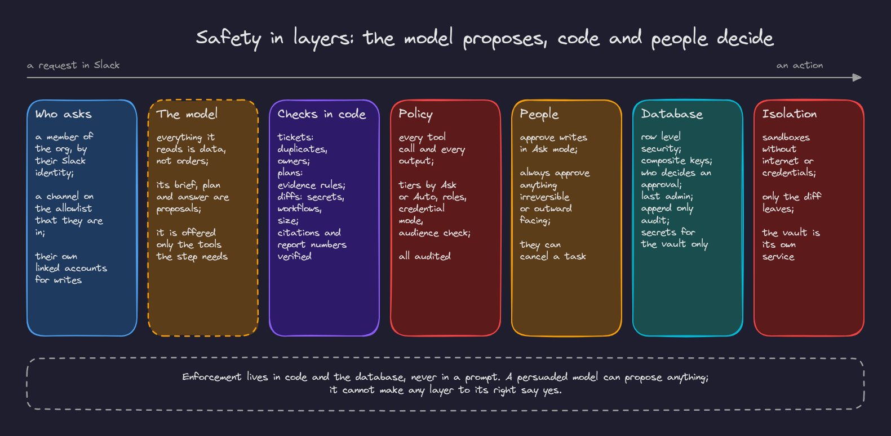

# 2. Security and multi tenancy

## Safety in layers

**Decision.** Treat the model as untrusted. It proposes; checks in code, the policy module, people, the database and isolation decide. Enforcement lives in code and the database, never in a prompt (invariant 3).

**Why.** Anything the agent reads (a Slack message, a Jira description, a code comment, a log line) can contain instructions. Prompt rules reduce the chance a model follows them; they cannot guarantee it. A design where a persuaded model still cannot do harm does not depend on the model's judgment.

**Tradeoffs.** More code: every playbook's outputs need checks (tickets, plans, diffs, numbers), and some legitimate requests are refused or asked about that a trusting design would just do. We accept that; the refusals say why.

## Row level security with a unit of work

**Decision.** Every tenant table has `org_id` and a row level security policy on a transaction scoped setting. Each request's unit of work sets the org in the same transaction and commits before the response starts; children reference parents through composite `(org_id, id)` foreign keys. (Spec 13.1, D-043; invariants 1 and 9.)

**Why.** Isolation enforced by the database holds even when a query in the application forgets a filter. Composite keys close the gap row level security leaves open (foreign key checks bypass it). Committing before the response means a client never sees a success that was then rolled back.

**Tradeoffs.**
- Cross tenant work (resolving a Slack workspace before the org is known, maintenance jobs) needs narrow `security definer` functions.
- The setting must be transaction scoped because PgBouncer reuses server connections; a session setting would leak.
- Tests must use a real Postgres; row level security is never mocked.

**Alternatives.** A schema or database per tenant (strong isolation, but migrations and pooling multiply with every customer); application level filtering (simple, but one forgotten `where` leaks data).

## A database login per component

**Decision.** The API and worker log in as `app_user`; the vault, identity sync and maintenance each have their own login and role. Only the vault's role can read secret ciphertext. Nothing relies on `BYPASSRLS`. (Spec 13.2, D-034.)

**Why.** A compromised or buggy component can do only what its role allows. Managed Postgres may not grant `BYPASSRLS`, and code that relied on it would fail open or not at all.

**Tradeoffs.** More credentials to provision (Render generates them; `app migrate` creates the logins without rewriting unchanged passwords, which would break PgBouncer's pass-through). More grants to keep right, checked by the schema suite.

## The policy module in code

**Decision.** One module approves, asks for approval or denies every tool call, and checks every output's audience. Every decision is audited. Approval decisions are additionally enforced by a database trigger. (Spec T3, 9.2.)

**Why.** One place to read and test the rules; nothing reaches a tool without passing it. The trigger means no code path, buggy or not, can approve on the wrong person's behalf.

**Tradeoffs.** Rules are Python, not a policy language. As rules grow, a dedicated engine (Cedar, OpenFGA) may be worth it; the interface was designed so it can be swapped in.

**Alternatives.** Checks scattered in each adapter (easy to miss one); a policy engine from day one (more moving parts before the rules justified it).

## Act within the requester's access

**Decision.** The agent reads a channel only if it is on the admin's allowlist **and** the requester is a member. Each operation has a credential mode: `org`, `org_with_check` (results filtered to what the requester may see) or `user_required` (the requester's own linked account, for every write). Outputs are checked against the destination's audience. (Spec P4, P9, T4, T6; invariant 4.)

**Why.** Without this the agent becomes a way around permissions: anyone could ask it to summarize a private channel or file a ticket in a project they cannot see.

**Tradeoffs.**
- People must link their Jira and GitHub accounts before the agent writes for them.
- Some answers go privately instead of to the channel, which surprises people the first time (the thread says why).
- Membership must be known, so channel members are synced, cached and reconciled.

**Alternatives.** User tokens for Slack reads (rejected: every person would have to grant broad scopes, T6); acting as the bot everywhere (rejected: it leaks).

## A separate vault service

**Decision.** The vault is its own private service, the only holder of the encryption keys, provider client secrets, the GitHub App key and its database user. It exchanges OAuth codes, refreshes tokens under a lock, mints installation tokens and releases a person's link only to their own running task. Secrets are sealed with envelope encryption (AES-256-GCM data keys wrapped by per tenant keys derived from a versioned master key). (D-049, D-110, D-112; invariant 5.)

**Why.** If the API or worker were compromised, the attacker would still not hold long lived secrets or the keys to decrypt them. Task scoping means a credential cannot be used for someone else's work.

**Tradeoffs.** A network hop for every credential, one more service to deploy and monitor, and a startup ordering concern on first deploy.

## No raw Slack text stored

**Decision.** Raw Slack messages are never stored, not even in Temporal history. Workflow inputs carry references only; the activity that reads Slack also calls the model and returns only derived content (brief items, findings, the answer) and permalinks. (Spec T13, D-087; invariant 7.)

**Why.** Slack's terms and customers' privacy. Temporal history and our database are storage; keeping message text out of both keeps the promise simple.

**Tradeoffs.** A task re-reads Slack when it needs the conversation again; a task's title in the console is the brief's goal, not the original message; debugging relies on derived artifacts and permalinks.

## Humans approve what cannot be undone

**Decision.** Irreversible or outward facing actions always need approval, whatever the mode; merging and deploying are not available to the agent at all. (Invariant 10.)

**Why.** Reversible mistakes can be fixed; irreversible ones cannot. A person deciding is the last layer for exactly the actions where the other layers matter most.

**Tradeoffs.** Posting a summary to another channel always takes a click. We think that is right.
