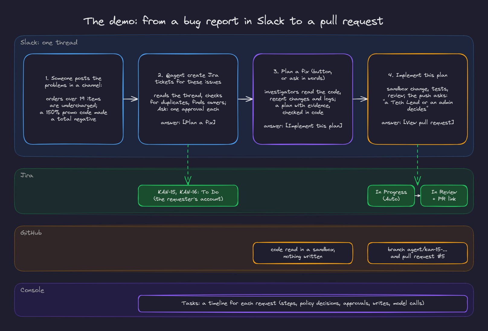

# 1. The demo, step by step

The demo follows one bug report from a Slack channel to a pull request. It exercises most of the platform: reading Slack, Jira writes with approvals, investigation in a sandbox, a code change with tests and review, the trusted push, tickets that follow the work, and the console's view of all of it.

The steps below are from a real run on staging (run 6 in `docs/demo_test_log.md`), in Ask mode, against a small demo repository (`tahier-agent-lab/cart-service`) that has two planted bugs.

## Before you start

- You are a member of the org, and your Jira and GitHub accounts are linked in the console (Integrations).
- The channel (`#agent-test`) is on the allowlist and you are in it.
- Optional: a "Tech Lead" role that approves pushes (Roles page), so the push approval shows routing.
- Ask or Auto: in Ask the agent asks before each change; in Auto it acts within your access (see [autonomy](07-autonomy-and-approvals.md)).

## 1. Post the problems

> Support escalated two pricing problems in tahier-agent-lab/cart-service:
> - Orders with more than 19 items are undercharged: only the first 19 lines count toward the total.
> - A 150% promo code made an order total go negative (-$43.20). Discounts above 100% must be refused.

## 2. Ask for tickets

In the thread: `@agent create Jira tickets for these issues`.

- A status message appears and updates in place: understanding, reading the thread, planning.
- The agent checks for open duplicates, picks the project and suggests an owner from the service catalog (CODEOWNERS of the pricing code), with the evidence.
- In Ask mode, two approval requests appear together, each saying what will be created, for whom, and "the requester or an admin decides". Approve both.
- KAN-15 and KAN-16 are created with your Jira account and linked in the answer. The answer has a **Plan a fix** button. About a minute in all.

## 3. Plan a fix

Click **Plan a fix** (or ask in words). The button is replaced by "@you chose Plan a fix" and a new task starts in the same thread.

- Code finds the case file: the two tickets, the service, the time window.
- Three investigators run in parallel: the code (read in a sandbox at a pinned commit), recent changes (commits and their diffs) and logs (where a log source is configured).
- The answer is a plan titled "Plan for KAN-15, KAN-16: Count every cart line and refuse discounts over 100% · confidence high", with evidence citing the exact lines (`cart.py#L23`), ranked hypotheses, steps starting with a failing test, risks, verification and rollback. It noticed these bugs had come back after earlier tickets were closed without a regression test.
- The answer has an **Implement this plan** button. About 70 seconds.

## 4. Implement it

Click **Implement this plan**.

- The agent prepares a sandbox, adds failing tests, fixes the code, runs the tests, checks that the new tests fail without the fix, and has a separate reviewer look at the plan and the diff.
- The push needs approval. The request lists the branch, the files and lines (2 files, +50 −4), "Verified: All tests pass", that KAN-15 and KAN-16 will move to In Review, and "**a Tech Lead or an admin decides**" (because the Tech Lead role approves pushes). Approve.
- Pull request #5 opens on a branch under `agent/`, with the plan and what was verified. The answer has a **View pull request** button.

## 5. Watch the tickets

On the Jira board, KAN-15 and KAN-16 are To Do after step 2. In Auto they move to In Progress when the change starts; when the pull request opens they move to In Review, each with a comment linking it.

## 6. See what happened

In the console, **Tasks** lists the three tasks with their status, duration and tokens. Open the change's task for its timeline: the brief, every sandbox edit and test run, the review, the policy's decisions (and that the follow up writes were done under the approval you gave), the approval and who decided it, the push, the ticket moves and comments, each model call and its purpose, with links to the pull request and the Slack thread.

## Afterwards

To run it again, move the tickets to Done and close (do not merge) the pull request, so the repository still has both bugs and the agent does not flag the new tickets as duplicates.
