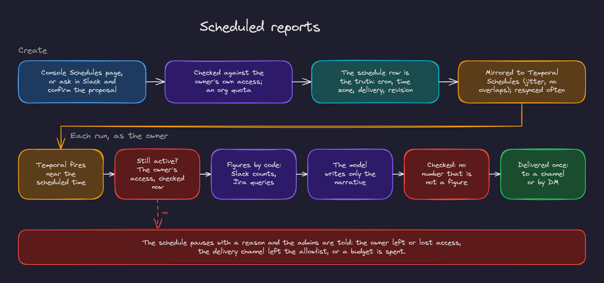

# 6. Scheduled reports

Recurring reports delivered to a channel or by DM: a daily summary of a channel, or a Jira progress report.

## Creating one

- **In the console** (Schedules page): choose the report (channel summary or Jira progress), the channel or project, a cadence and time zone, and where it goes (a channel or your DMs). Preview it before saving.
- **In Slack**: `@agent send me a summary of #bugs every weekday at 9`. The agent turns it into a proposal with a **Confirm** button.

Anyone can create schedules, limited to the channels and tools they can access themselves. Orgs have a limit on active schedules, and cadences are at most hourly.

## Every run

1. Temporal fires the run near the scheduled time (with a little jitter, so every org's 9 AM report does not run at the same instant; overlapping runs are skipped).
2. The schedule must still be active, and the **owner's access is checked again**: their membership, the channels and the Jira project. Permissions are evaluated at every run, not only when the schedule was created.
3. **Numbers are computed by code**: message counts and threads for a channel; issues opened, closed and in progress for a Jira project.
4. **The model writes only the narrative**: a short summary and highlights from the source lines, each citing its sources.
5. **The narrative is checked**: it may not state a number that is not among the computed figures.
6. The report is delivered once per run, even if the run is retried.

## When a schedule pauses

A schedule pauses with a reason, and the admins are told, when its owner is removed or loses access, when its delivery channel leaves the allowlist, or when a budget is spent. Admins can reassign or delete it; the owner can resume it once the cause is fixed.

## Managing schedules

| Where | Who | Can |
|---|---|---|
| Console, Schedules page | Owners and admins | Create, edit, pause, resume, run now, preview, reassign, delete |
| Slack, App Home | Owners | Run now, pause, resume, delete |

The schedule row in the database is the truth; Temporal Schedules mirror it, and a maintenance job resyncs every 15 minutes so the two never drift.
