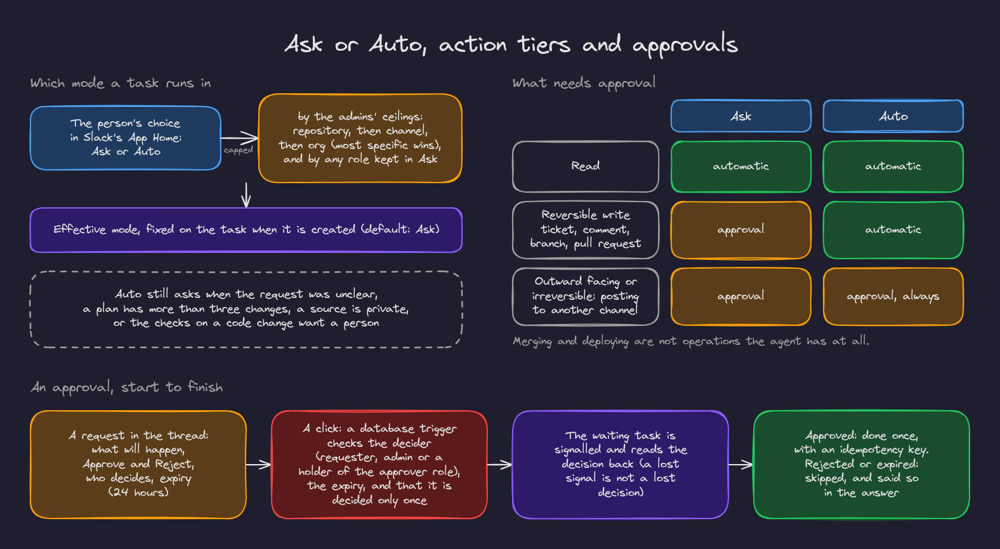

# 7. Autonomy and approvals

How much the agent does on its own is a choice each person makes, within limits their admins set.

## Ask or Auto

- **Ask**: the agent asks before every change.
- **Auto**: it makes reversible changes (a ticket, a comment, a branch, a pull request) within your access without asking.

You choose in Slack's App Home ("How should I act?"). Your choice is capped by:

- **the admins' ceilings**: per org (console, Settings, Autonomy: "Ask before every change" or "Let people choose Auto"); the schema also supports ceilings per channel and per repository, where the most specific wins,
- **your roles**: a role can keep its holders in Ask (see [roles](08-roles.md)).

With no settings the mode is Ask. The effective mode is fixed on each task when it is created, by a database function, so the App Home and the task always agree.

Even in Auto, the agent asks when the request was unclear, when a plan has more than three changes, when a source is private, or when the checks on a code change want a person.

## Action tiers

| Tier | Examples | Ask | Auto |
|---|---|---|---|
| Read | Search, read, summarize | Automatic | Automatic |
| Reversible write | Create a ticket, comment, assign, open a branch and pull request | Approval | Automatic |
| Outward facing or irreversible | Post in another channel | Approval, always | Approval, always |

Merging and deploying are not operations the agent has at all.

## Approvals

An approval request in the thread shows exactly what will happen (for a post, a preview of the text; for a push, the files, lines and what was verified), with **Approve** and **Reject**, who may decide, and when it expires (24 hours).

Who may decide depends on the action: the requester, an admin, or either; or, when an admin routed the operation to a role, a holder of that role or an admin. A **database trigger** enforces it: the wrong person is refused (and told privately), an expired request cannot be decided, and a decision is final. The rule and the role are fixed when the request is made.

When a plan has several actions needing approval, the requests appear together, and each action happens as soon as its own decision arrives. Rejected or expired actions are skipped and reported in the answer.

## Shadow mode

An org setting (console, Settings, Agent) in which the agent reads, plans and answers, and says what it would have done, but makes no changes at all: no tickets, no posts elsewhere, no pull requests. Orgs created by self service sign up start in it; admins turn it off once they trust the agent's plans.

## Cancelling

Every running task has a **Cancel** button on its status message (for the requester and admins). Cancelling stops at the next safe point; it never interrupts a write in progress, and pending approvals expire.
