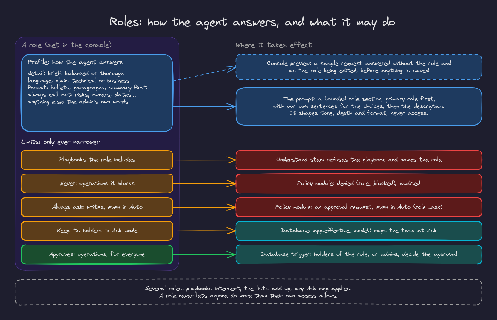

# 8. Roles

Roles let one agent serve people with different jobs. A role's **profile** shapes how the agent answers its holders; its **limits** narrow what the agent does for them; a role can also **approve** certain actions for everyone. A role never lets anyone do more than their own access allows.

## Creating a role

Console, Roles page, **New role** (admins). Assign roles on the Members page; a person can hold several, and exactly one is their primary role.

### Profile: how the agent answers

| Choice | Options |
|---|---|
| Detail | Brief, Balanced, Thorough |
| Language | Plain language, Technical, Business impact |
| Format | Bullets, Paragraphs, Summary first |
| Always call out | Risks, Next steps, Owners, Dates, Code, Customer impact, Metrics |
| Anything else | Free text in the admin's own words |

The choices become fixed sentences in the agent's prompt ("Keep answers short: the essentials in a few bullets", "Speak to impact rather than implementation details", "Call out risks and dates"), followed by the description. Fixed choices keep the prompt predictable; only the description is free text, and it is cleaned and capped.

### Preview before saving

The role editor has a **Preview** panel. It sends a sample request ("Summarize this thread for me", "Where do things stand?", "How should we fix this?", or your own question) about a sample Slack thread to the real model twice: once as the role being edited (unsaved choices included) and once without any role. The two answers appear side by side, so an admin sees what a profile changes before anyone is affected. Previews are metered to the org like any model call; nothing is stored.

### Limits: what the agent may do for the role's holders

| Limit | Effect | Enforced by |
|---|---|---|
| Playbooks | Only the playbooks the role includes (for example questions and tickets, but not code changes) | The understand step refuses others and names the role |
| Never | Operations the agent never does for them (for example pushing code) | The policy module denies them, audited |
| Always ask | Writes that need approval even in Auto | The policy module |
| Ask mode only | Holders stay in Ask whatever they choose | The database function that computes the mode |

With several roles the most restrictive wins: playbooks intersect, the lists add up, any Ask cap applies.

### Approves: routing approvals to a role

A role can approve operations for everyone. With a "Tech Lead" role that approves `GitHub: push changes`, every push approval in the org says "a Tech Lead or an admin decides", and the database lets only holders of that role, or admins, decide it.

## Where roles show up

- Role cards on the Roles page list the profile and the limits.
- The App Home shows a person's roles.
- Buttons on answers respect them: a role without code changes never gets an **Implement this plan** button.
- Refusals name the role: "Your role (Support) doesn't include _implement the plan and open a pull request_, so I haven't started on it. An admin can change what a role includes on the console's Roles page."
