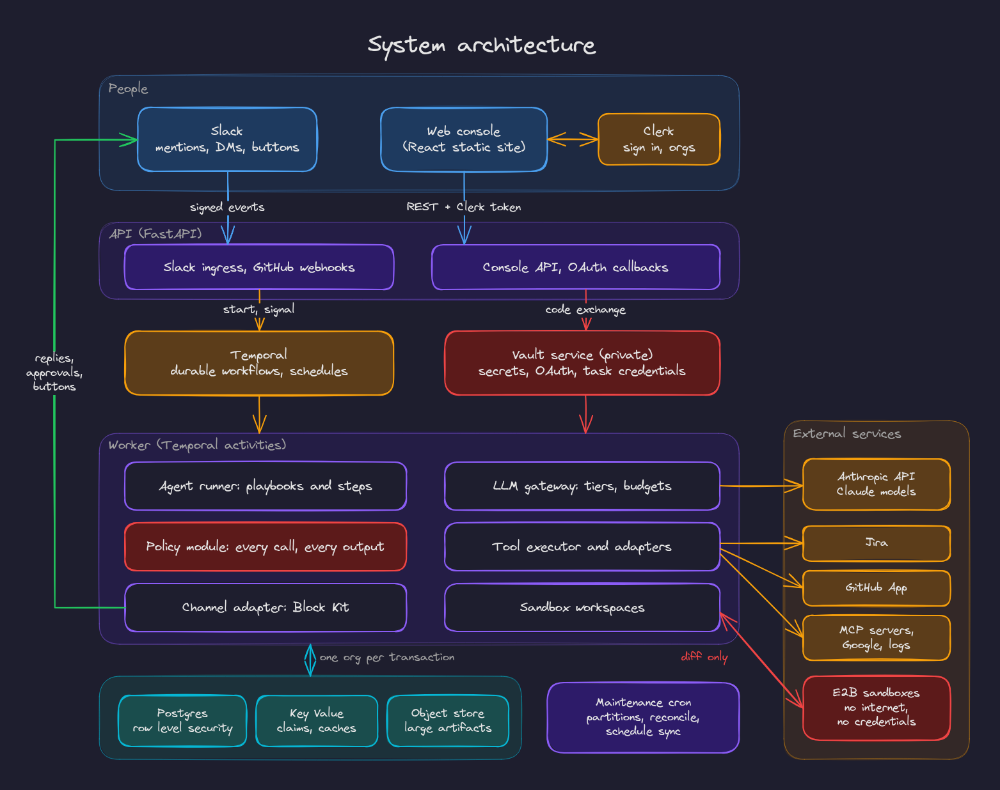
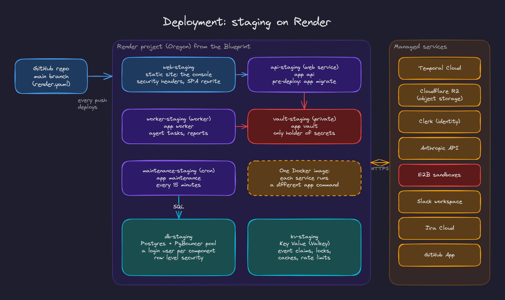

# 1. Architecture

## Components

| Component | Responsibility | Where in the code |
|---|---|---|
| Web console | Admin and member UI: members, roles, Slack channels, integrations, catalog, repositories, schedules, tasks, usage, settings, audit | `web/` |
| API | Slack ingress (events and button clicks), GitHub webhooks, the console's REST API, OAuth callbacks, health checks. It never runs agent work itself | `backend/app/api/` |
| Temporal | Durable workflows: one per request, approval waits, retries, timers, scheduled reports | Temporal Cloud on staging; workflows in `backend/app/workflows/` |
| Worker | Runs the workflows' activities: the agent's steps, report runs, Slack syncs, follow ups | `backend/app/worker.py`, `backend/app/agent/` |
| Agent runner | The steps of a task: understand, gather, plan, act, verify, report, and the investigation and implementation paths | `backend/app/agent/runner.py`, `investigation.py`, `implementation.py` |
| Policy module | Approves, asks for approval or denies every tool call, and checks every output's audience | `backend/app/policy/` |
| LLM gateway | Every model call: tier resolution, budgets, rate limits, retries and fallback, metering, tracing without content | `backend/app/llm/` |
| Tool executor and adapters | Slack, Jira, GitHub, MCP servers, logs, the service catalog and sandbox tools behind one interface | `backend/app/tools/` |
| Channel adapter | Turns the agent's intents (reply, status, approval request, report) into Slack Block Kit within Slack's limits and rate limits | `backend/app/slack/adapter.py` |
| Vault service | The only holder of secrets: OAuth exchange and refresh, GitHub App installation tokens, task scoped credentials | `backend/app/vault_service/` |
| Maintenance cron | Monthly partitions, Slack and task reconciliation, schedule sync, expired sandboxes, retention, org offboarding, alerts | `backend/app/maintenance.py` |
| Sandboxes | Per task working copies of a repository, with no network and no credentials | `backend/app/sandbox/` (E2B on staging) |
| Stand-ins | Local fakes of every external service, speaking their real HTTP APIs | `fakes/` (never deployed) |

## Technology

| Layer | Choice |
|---|---|
| Backend | Python 3.12, FastAPI, psycopg 3 (async, connection pools), Pydantic, httpx, the Temporal Python SDK |
| Data | PostgreSQL 16 with row level security, PgBouncer in transaction mode, Valkey (Redis compatible Key Value), S3 compatible object storage |
| Model | Anthropic's Messages API (Claude), called over HTTP through our own gateway, with tiers per step |
| Console | React 19, TypeScript (strict), Vite, React Router, TanStack Query, Tailwind CSS, Clerk for sign in |
| Sandboxes | E2B microVMs (staging); a local runner container with no network (development) |
| Observability | Structured JSON logs, OpenTelemetry traces (Jaeger locally) |
| Tooling | uv, ruff, mypy (strict), pytest; pnpm, ESLint, Prettier, Vitest; Playwright |
| Deployment | One Docker image, a Render Blueprint (`render.yaml`) |

## One image, many commands

`backend/Dockerfile` builds a single image. The `app` command picks the process:

| Command | Process |
|---|---|
| `app api` | The API (the image's default) |
| `app worker` | The Temporal worker |
| `app vault` | The vault service |
| `app maintenance` | One run of the maintenance jobs (a cron) |
| `app migrate` | Apply migrations and create each component's database login |
| `app seed` | Load the development fixture |
| `app check model` / `app check sandbox` | Smoke checks against the real model and sandbox provider |
| `app eval` | Replay the agent's evaluation cases |

Every service runs the same code at the same commit, so there is no version skew between, say, the API that starts a workflow and the worker that runs it.

## Process boundaries

The API answers HTTP quickly and never waits on a model or a tool. Anything slow, retryable or long running is a Temporal workflow executed by the worker. A request's transaction commits before its HTTP response starts (invariant 9), so a client never sees a success that was later rolled back.

The vault is its own service on the private network. The API and worker call it over HTTP with a service token; only the vault holds the provider client secrets, the GitHub App private key and the encryption keys. The worker's database user cannot read secret ciphertext at all.

## Deployment

Staging is defined by `render.yaml` and deployed by Render from the `main` branch:

| Service | Type | Command |
|---|---|---|
| `web-staging` | Static site | The console's production build, with security headers and an SPA rewrite |
| `api-staging` | Web service | `app api`; before each deploy, `app migrate` |
| `worker-staging` | Background worker | `app worker` |
| `vault-staging` | Private service | `app vault` |
| `maintenance-staging` | Cron, every 15 minutes | `app maintenance` |
| `db-staging` | Render Postgres | Behind a PgBouncer pool; one login user per component |
| `kv-staging` | Render Key Value | Event claims, locks, caches, rate limit counters |

Around them: Temporal Cloud, Cloudflare R2 for object storage, Clerk for identity, the Anthropic API, E2B for sandboxes, a Slack workspace, Jira Cloud and a GitHub App.

Migrations run in the API's pre-deploy step, so a migration that fails stops the deploy before new code serves traffic. Migrations must be safe for the previous code version, because the worker may still be on it for a minute.

See [Quality and operations](09-quality-and-operations.md) for local development and the deploy runbook.
