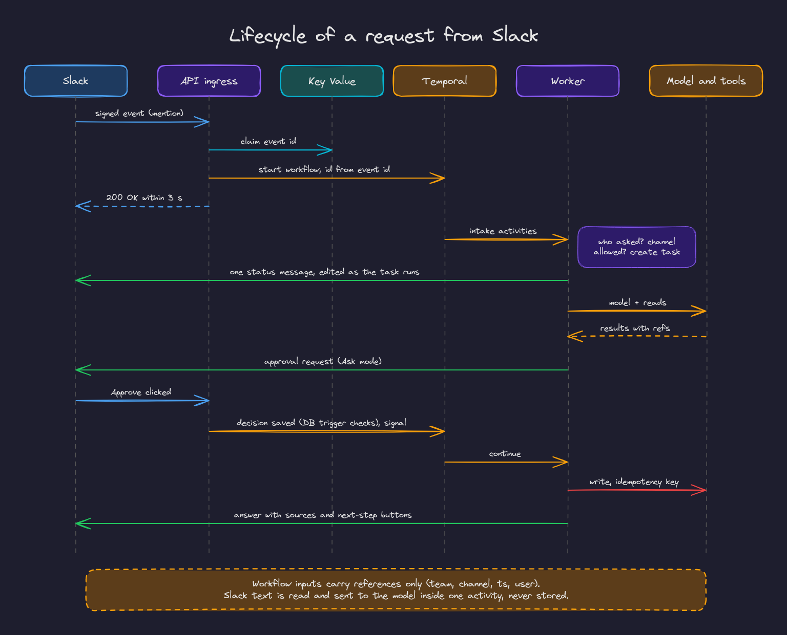
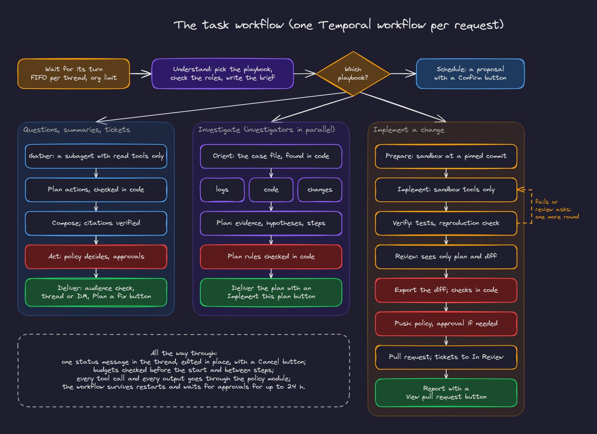

# 2. The life of a request

This chapter follows one Slack mention from the signed event to the answer in the thread.

## 1. Ingress: verify, claim, start, answer (under three seconds)

Slack sends events to `POST /slack/events` and button clicks to `POST /slack/interactions` (`backend/app/api/slack.py`). For each one the API:

1. **Verifies the signature** on the raw body with the signing secret, and rejects stale timestamps.
2. **Claims the event id** in Key Value. Slack retries deliveries; a retry finds the claim and is acknowledged without doing anything.
3. **Resolves the workspace to its org** through a `security definer` function (the org is not known yet, so this cannot run under row level security).
4. **Starts a workflow** whose id is derived from the event id (`slack-<event id>`), so even a double start is refused by Temporal.
5. **Answers 200** well within Slack's three second limit. If starting the workflow fails, it releases the claim and answers 500 so Slack retries.

The workflow input carries references only: org, workspace, team, channel, user, message timestamp, thread timestamp, event id. **Never the message text.** Temporal keeps workflow history, and invariant 7 says raw Slack messages are never stored.

## 2. Intake: who is asking, and may they ask here?

`AgentRequestWorkflow` (`backend/app/workflows/slack.py`) runs three short activities:

1. **Identify the requester**: the Slack user is mapped to an org member through their platform identity, or by email when their Slack email matches an invited member. Someone who is not a member gets a private reply explaining how to get access, and the admins get a DM with a one click invite.
2. **Check the channel**: it must be on the admin's allowlist, not archived, and the requester must be a member of it (`app.can_read_channel`). DMs with the bot are always allowed for members; group DMs are not supported.
3. **Create the task**: one session per Slack thread (or DM), and a task row with the requester, the trigger and the **effective mode**, computed by the database function `app.effective_mode` (the person's Ask or Auto choice, capped by the most specific admin ceiling and by their roles).

It then starts the task as a child workflow (`TaskWorkflow`, id `task-<event id>`) and finishes.

## 3. The task workflow

`TaskWorkflow` (`backend/app/workflows/task.py`) is the durable outline of the work. Each box in the diagram is a Temporal activity in `TaskActivities`, implemented by `AgentRunner` and its helpers. The workflow itself holds no secrets and no message text; activities read what they need and return derived results.

**Waiting for its turn.** Tasks in one thread run one at a time, first in, first out. The org also has a limit on concurrent tasks. Budgets (per task, per person per day, per org per month) are checked before the task starts.

**Understand.** The request is classified to a playbook by a fast model call (or chosen by a button, see below). The requester's roles are checked: a playbook their roles exclude is refused, with the role named. Then the model writes a **brief** of the conversation: goal, facts, decisions, open questions, the channels, issue keys, repositories and files mentioned, each item citing the messages it came from.

From here the path depends on the playbook:

- **Questions, summaries and Jira tickets** (`slack_qa`, `jira_tickets`): an isolated subagent **gathers** with read tools only; the model **plans** actions, which code checks (ticket duplicates, owners, projects); the model **composes** the answer, whose citations code verifies; the policy decides each action (**act**); the answer is **delivered**.
- **Investigations** (`investigate_issue`): code finds the case file (the issue, the service, the time window); three investigators (logs, code, recent changes) run **in parallel** as separate activities; a plan is written and checked against rules in code. See [the agent runtime](03-agent-runtime.md).
- **Code changes** (`implement_change`): prepare a sandbox at a pinned commit, implement through sandbox tools, verify with the tests, review, export the diff, check it, push it. See [code changes and sandboxes](05-code-changes-and-sandboxes.md).
- **Schedules** (`schedule_create`): the request becomes a proposal the person confirms with a button.

**Between steps** the workflow checks budgets again. When a budget runs out it stops cleanly after the current step, never in the middle of a write, and says what was done.

**One status message.** The task posts a single status message in the thread ("Understanding the request…", "Reading #bugs…", "Waiting for approval…", "Done · 18,546 tokens") and edits it as it goes, with a Cancel button while it runs. Cancelling never interrupts a write in progress.

## 4. Acting, and waiting for people

For every planned action the policy module returns one of three outcomes (see [security](04-security-and-tenancy.md#the-policy-module)):

- **Allowed**: the activity executes it, with an idempotency key.
- **Needs approval**: an approval row is created and a message with Approve and Reject buttons is posted in the thread. When several actions need approval, all requests are posted together and each action runs as soon as its own decision arrives.
- **Denied**: the reason is reported in the answer.

A click reaches `/slack/interactions`. The API writes the decision; a **database trigger** checks that the person may decide (the requester, an admin, or a holder of the approver role, depending on the action), that the request has not expired and that it was not already decided. The API then signals the workflow. The workflow does not trust the signal alone: it re-reads the decision from the database, and it polls every 15 minutes while it waits, so a lost signal is never a lost decision. Approvals expire after 24 hours.

## 5. Delivering the answer

Before posting, the output check compares the answer's sources with the destination's audience. If someone in the channel could not see one of the sources (a private channel, a Jira project or repository they lack access to), the answer goes to the requester by DM and the thread gets a short note saying why.

The answer is rendered as Slack Block Kit by the channel adapter: sections within Slack's size limits, citations as links, and, when there is an obvious next step, buttons (Plan a fix after tickets, Implement this plan after a plan, View pull request after a push). A click on such a button starts a new request in the same thread as the person who clicked; the button carries an intent key, never text, and the runner maps it to a playbook and a request our code wrote.

Every write the agent makes in Slack goes through `post_once`: an idempotency key is recorded in `external_actions` before posting and stored in the message's metadata, so a retried activity never posts twice.

## Durability in practice

| Failure | What happens |
|---|---|
| The worker restarts mid task | Temporal replays the workflow from its history and continues from the last completed activity |
| An activity fails (network, 5xx) | Temporal retries it with backoff; permanent errors (a revoked Slack token) are marked non retryable |
| A write times out after the provider acted | The idempotency key is looked up first (a Jira label, a commit trailer, Slack metadata), so the retry finds the earlier write instead of repeating it |
| Slack delivers an event twice | The Key Value claim and the workflow id both stop the second one |
| A signal is lost | The waiting workflow re-reads the approval from the database |
| The workflow code changes while tasks run | Changes to the order of commands are guarded with `workflow.patched(...)`, so old histories still replay |
| A task's workflow disappears | The maintenance job marks the task failed and closes its status message |
