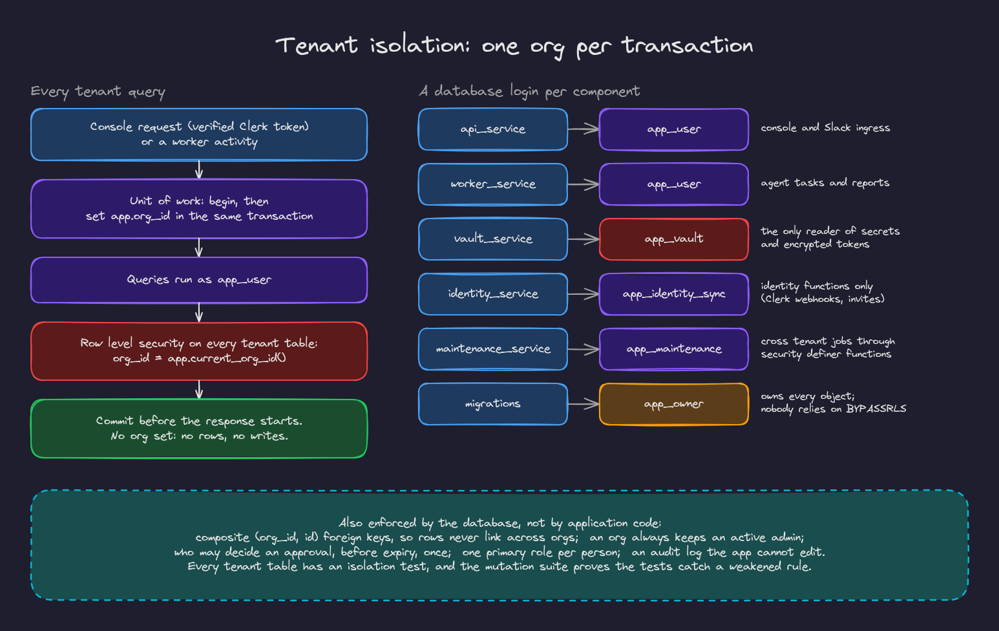
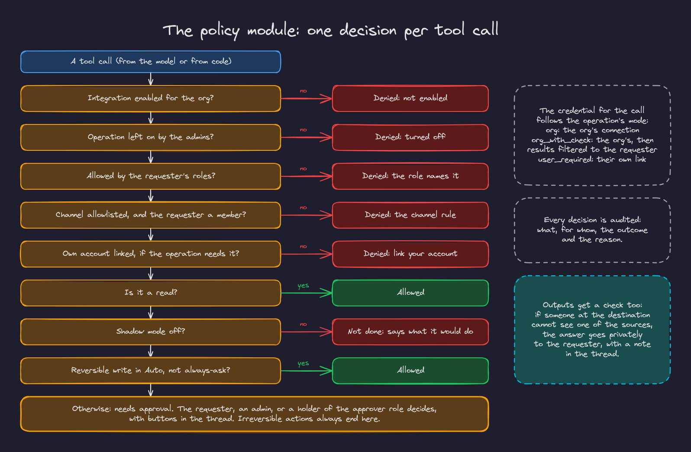
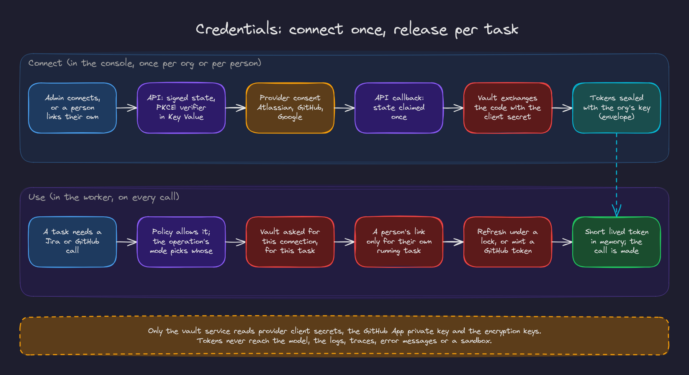

# 4. Security and multi tenancy

Three principles shape the design: the agent acts **within the requester's own access**; safety is enforced **in code and in the database, never in a prompt**; new use cases come from tools, playbooks and roles rather than new code paths.

## The ten invariants

Every change in the repository keeps these (they are written down in `CLAUDE.md`, and a change that would weaken one stops and is raised instead):

1. Tenant data is only read or written inside a unit of work bound to one org (`app.org_id` set in the same transaction).
2. Request paths connect as `app_user` only; the identity, maintenance and vault roles are used only by their own components.
3. The policy module is called before every tool call and every output.
4. The agent acts within the requester's own access: channel allowlist plus membership, credential mode per operation, audience check on output.
5. Secrets never appear in model context, logs, traces or error messages.
6. The sandbox never holds push credentials; only the diff leaves it.
7. Raw Slack messages are never stored; only derived artifacts and permalinks.
8. Every external write has an idempotency key checked before acting.
9. The transaction commits before the HTTP response starts.
10. Irreversible actions always need human approval.

## Tenant isolation

Every tenant table has an `org_id` column and a row level security policy: `org_id = app.current_org_id()`, which reads a transaction scoped setting. The API's unit of work (`backend/app/db/uow.py`) opens a transaction, sets `app.org_id` to the verified org, runs the handler's queries and commits before the response starts. Activities do the same with `tenant_tx(pool, org_id)`. Without the setting a query sees no rows and cannot write.

The setting is always transaction scoped, never session scoped, because PgBouncer in transaction mode hands the same server connection to the next client.

Children reference parents through composite `(org_id, id)` foreign keys. Foreign key checks bypass row level security, so without this a guessed id could link a row to another org's row; with it the database refuses.

### Database roles

| Login | Role | Can do |
|---|---|---|
| `api_service`, `worker_service` | `app_user` | Tenant tables under row level security; read only on people; append only on audit and usage |
| `vault_service` | `app_vault` | The only role that reads or writes secret ciphertext |
| `identity_service` | `app_identity_sync` | Identity functions only (Clerk webhooks, invitations, privilege changes); cannot read work data |
| `maintenance_service` | `app_maintenance` | Cross tenant jobs, through `security definer` functions |
| migrations | `app_owner` | Owns every object |

Nothing relies on `BYPASSRLS` (managed Postgres may not grant it). Work that must cross tenants, such as resolving a Slack workspace to its org before the org is known, goes through narrow `security definer` functions with `execute` granted only to the role that needs it.

### Tested, and the tests are tested

Every tenant table is in an isolation suite: org A cannot read, insert, update, link or delete org B's rows, and no context means no rows. A meta test fails if a new tenant table is not in the suite. The mutation script (`scripts/schema_mutations.sh`) weakens one guarantee at a time (drops a policy, grants a column, removes a trigger) and checks that the suite notices; all 26 mutations are caught.

## The policy module

`Policy.check_tool` (`backend/app/policy/__init__.py`) decides every tool call, whether the model proposed it or code did:

1. Is the integration enabled for the org, and the operation not turned off by an admin?
2. Do the requester's roles block it?
3. For channel operations: is the channel allowlisted, not archived, and the requester a member?
4. If the operation needs the requester's own linked account (all writes do), is it linked?
5. Reads are allowed. In shadow mode, writes are not done; the agent says what it would have done.
6. A reversible write in Auto mode is allowed, unless a role makes it always ask.
7. Otherwise the action needs approval, decided by the requester, an admin, or holders of an approver role.

The decision also fixes the **credential mode**: `org` (the org's connection), `org_with_check` (the org's connection, with results filtered to what the requester may see) or `user_required` (the requester's own link). Every decision is written to the audit log with its reason.

`Policy.check_output` checks every answer and post against its destination: if anyone there could not see one of the sources, the answer goes privately to the requester instead.

## Credentials and the vault

- **Connecting**: OAuth flows use signed, single use state (claimed once in Key Value) and PKCE. The callback hands the code to the vault, which exchanges it with the client secret and stores the tokens sealed with the org's key (envelope encryption with per tenant data keys and key rotation).
- **Using**: a task asks the vault for a credential for a connection, with its task id. A person's link is released only to their own running task; org connections are refreshed under a per connection lock (refresh tokens rotate); GitHub installation tokens are minted from the App key. The worker gets a short lived token in memory.
- **Only the vault** reads provider client secrets, the GitHub App private key and the encryption keys. The worker's database user cannot read secret ciphertext.

## Prompt injection and output safety

- Everything the agent reads is treated as data. The rules say so, but more importantly nothing in the prompt can grant access: tools are filtered before the model sees them, and every call is decided by the policy module.
- Steps are offered only the tools they need; the code reviewer and the plan writer have no tools at all.
- Tool output is capped and passed through secret redaction before the model sees it.
- Anything the model or a person wrote is escaped before it goes into Slack text, so it cannot become a mention, a channel broadcast or a disguised link.
- Model proposals that matter (tickets, plans, code changes, report numbers) are checked in code; see [the agent runtime](03-agent-runtime.md#structured-output-repaired-and-checked).

## Identity

The console verifies Clerk session tokens (issuer, audience, the `azp` origin, keys from the JWKS). Privilege always comes from our database, never from the token. Clerk webhooks (verified with Svix signatures and deduplicated) keep orgs, users and memberships in sync through identity functions that ignore events older than what they already applied, because webhooks arrive late and out of order. An org always keeps at least one active admin, enforced by a trigger with a row lock.

## Audit

The audit log is append only for the application. It records console changes (who changed what), identity syncs, every policy decision (tool calls and outputs, with the requester and the reason) and every approval decision. Admins filter it in the console; the Tasks page shows the same records per task.

## Other boundaries

| Boundary | Protection |
|---|---|
| Slack ingress | Signature on the raw body, timestamp window, event claim |
| GitHub webhooks | HMAC-SHA256 signature, delivery id claimed for 7 days; webhooks never start work on their own |
| Console | CORS limited to the console's origins, security headers and a content security policy on the static site |
| Sandboxes | No internet, no credentials, paths confined to the workspace, secret files never read, listed or shown |
| Logs and traces | No tokens, secrets or raw Slack text; spans carry the tenant id but never SQL parameters or prompt content |
