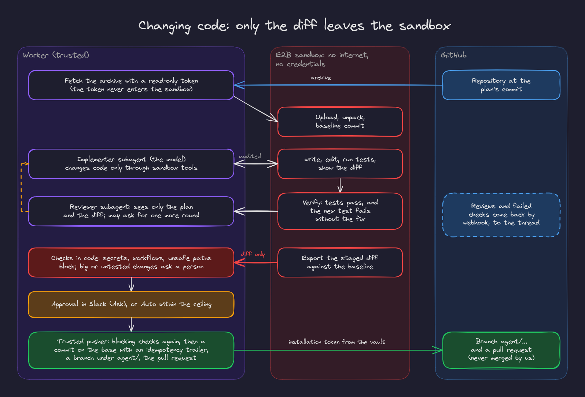

# 5. Code changes and sandboxes

Reading code and changing code both happen in sandboxes. The rule that shapes everything here: **the sandbox never holds a credential, and only the diff leaves it** (invariant 6).

## Sandbox providers

`SandboxProvider` (`backend/app/sandbox/`) is a small interface: create, upload an archive, list, read, search, write, run a command, export the diff, destroy. Two clients implement it with the same contract (paths stay inside the workspace, the same archive rules, the same output and read caps, the same messages):

| Provider | Where | Isolation |
|---|---|---|
| E2B (`SANDBOX_PROVIDER=e2b`) | Staging | A Firecracker microVM per sandbox from our template (Python 3.12, git, pytest, Node), created with internet access off, at most an hour |
| HTTP stand-in (`SANDBOX_PROVIDER=http`) | Development and tests | A separate `sandbox-runner` container with no network at all, a read only root, no capabilities, a non root user, CPU, memory and process limits |

`app check sandbox` runs every operation once against the configured provider, including a check that the internet does not answer.

## Working copies

A task gets one sandbox per repository, at a commit pinned on first use (`app.sandbox.workspaces.Workspaces`). Parallel investigators of the same task share it: the first one claims the row and builds it, the others wait. The task's end destroys its sandboxes; a maintenance job destroys any that expired.

**The token never enters the sandbox.** The platform downloads the repository archive with a read only GitHub installation token, checks the archive (no absolute paths, no `..`, no links or devices) and uploads it. A copy that will be changed gets a **baseline commit** of exactly what was uploaded, so its change can later be exported exactly.

Secret files (`.env*` other than examples, keys, credentials, Terraform state, service account files) are never read, searched, listed or shown in diffs.

## The implementation steps

`Implementation` (`backend/app/agent/implementation.py`) and the task workflow's implement path:

1. **Prepare, in code**: find the plan for this thread, the repository and the base commit; check the requester can push (`github.prepare_workspace` with `push: true`); build the working copy.
2. **Implement**: an implementer subagent changes the copy **only through sandbox tools**: `write_file`, `edit_file` (one exact, unique replacement), `run_command` (no network, at most ten minutes, output end only, redacted) and `show_diff`. These are reads in the policy's terms (they change only the task's own copy), but every call is still decided and audited. Workflow files, secret files and `.git` are never written.
3. **Verify, in code**: run the repository's tests (a setup recipe detected from the files, or set by an admin). If they pass and the change added a test, stash the rest of the change and run the tests again: **the new test must fail without the fix**. Two failed verifications stop the task with what was tried and the end of the output.
4. **Review**: a reviewer subagent with no tools sees only the plan and the diff. It approves or asks for changes; one round of changes goes back to the implementer.
5. **Export**: the staged diff against the baseline (the patch, plus each changed file's status, mode and content) is stored as the task's `diff` artifact: inline when small, in object storage when large.
6. **Check the change, in code** (`app.agent.changes.check_change`):

   | Blocks the push | Needs a person, even in Auto |
   |---|---|
   | Secrets in added lines, secret files, CI workflow files, unsafe paths (`..`, `.git`, absolute), links, submodules, binary files, no change | More than 20 files or 800 lines, protected paths, generated or vendored files, tests that could not run, no test added, a new test that passes without the fix, review comments addressed but not reviewed again |

7. **Push**, as an action through the policy: Ask asks, Auto pushes unless the checks or the repository's own ceiling say ask. The approval request lists the files, the line counts, what was verified and which tickets will move.

## The trusted pusher

`github.push_changes` (`backend/app/tools/github_changes.py`) is the only code that pushes, and it only runs through `AgentRunner.execute` with an idempotency key:

- It runs the blocking checks again, on the stored diff, just before pushing.
- It uses the GitHub App's installation token from the vault and the Git Data API: blobs, a tree on the base commit's tree, a commit whose only parent is the base and whose message ends with `Agent-Action: <key>`.
- It creates a new branch under `agent/` (named from the issue, the goal and the task id) or fast forwards a branch whose head is still the prepared base. Never the default branch, never forced.
- A retry after a lost answer finds its own commit by the trailer instead of pushing again.
- It finds or opens the pull request, with the plan, what was verified and what was not, and links it to the task.

The agent never merges and never deploys; it does not have those operations.

## Tickets follow the change

When the plan came from Jira tickets, the tickets move with the work: to In Progress when the change starts (only where the policy allows it without asking, i.e. in Auto), and to In Review with a comment linking the pull request once it opens. Those moves ride on the push's approval, which lists them, so a person approves once rather than once per status change.

## Feedback from GitHub

`POST /webhooks/github` verifies the HMAC signature and claims the delivery id, then maps the pull request to the task that opened it through `task_links`. Submitted reviews, failed check suites and closed or merged pull requests become a notice in the original Slack thread, read within the requester's access. Webhooks never start work on their own: the engineer asks in the thread ("address the review comments"), and the implement path revises the same pull request on its own branch.
