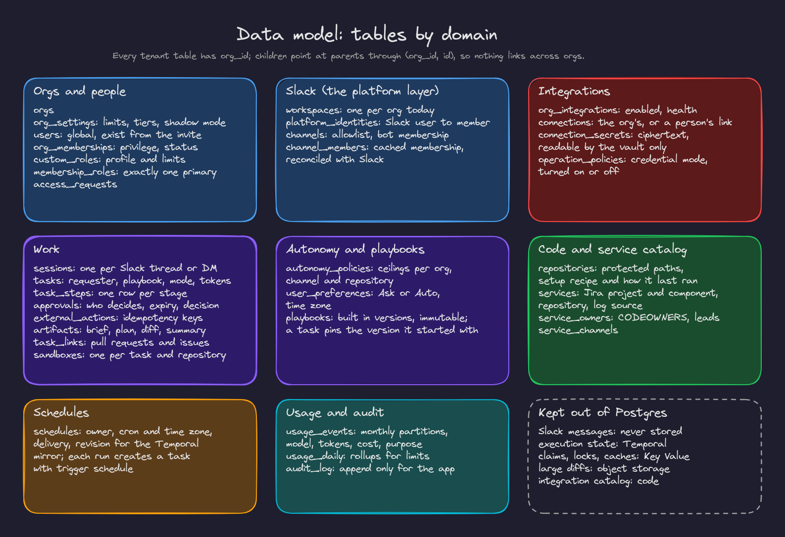

# 6. Data model

PostgreSQL is the source of truth for everything except execution state (Temporal) and large blobs (object storage). The full schema started as `spec/schema.sql`, tested against a live database before any application code existed, and became migration 001.

## Tables by domain

| Domain | Tables | Notes |
|---|---|---|
| Orgs and people | `orgs`, `org_settings`, `users`, `org_memberships`, `custom_roles`, `membership_roles`, `access_requests` | Users are global and exist from the moment they are invited, so Slack email matching works before they sign up. Clerk is the source of truth for identity, synced by webhooks |
| Slack | `workspaces`, `platform_identities`, `channels`, `channel_members` | `platform` columns leave room for other chat platforms; channel membership is a durable copy, cached in Key Value and reconciled with Slack |
| Integrations | `org_integrations`, `connections`, `connection_secrets`, `operation_policies` | The catalog of integrations and each operation's defaults live in code; the database stores what an org changed |
| Code and catalog | `repositories`, `services`, `service_owners`, `service_channels` | Protected paths and setup recipes per repository; services with their Jira project, component, repository and log source |
| Autonomy | `autonomy_policies`, `user_preferences` | Ceilings per org, channel or repository; each person's Ask or Auto |
| Playbooks | `playbooks` | Built in rows have no org; versions are immutable |
| Work | `sessions`, `tasks`, `task_steps`, `approvals`, `external_actions`, `artifacts`, `task_links`, `sandboxes` | The product's view of execution, for Slack updates, the console and audit |
| Schedules | `schedules` | Each run creates a task with trigger `schedule` |
| Usage and audit | `usage_events`, `usage_daily`, `audit_log` | Partitioned by month; append only for the application |

Ids are time ordered UUIDs (version 7). Statuses and kinds are text with check constraints rather than enum types, so values can evolve with simple migrations.

## Guarantees the database enforces

| Guarantee | Mechanism |
|---|---|
| Each org reads only its own rows; no context means no rows | Row level security on every tenant table |
| No inserting, moving or linking rows across orgs | Policies `with check` and composite foreign keys |
| Only the vault reads secrets | Grants plus row level security |
| Audit and usage are append only for the application | Insert and select grants only |
| An org always keeps an active admin, even under concurrent demotions | A trigger with a row lock |
| Several roles per person, exactly one primary, promotion when the primary goes | Partial unique index, deferred constraint trigger, promotion trigger |
| Effective mode: the person's choice capped by the most specific ceiling and their roles | `app.effective_mode()` |
| Channel reads need the allowlist and membership | `app.can_read_channel()` |
| Approvals decided only by the right person, before expiry, once; who decides cannot change | The `approvals_decision` trigger |
| Schedules: valid time zone and cron, target matches type, per org quota | Triggers and checks |
| Removing a channel from the allowlist pauses schedules delivering there | Trigger |
| Removing a member revokes their links, pauses their schedules, closes their sessions | Trigger |
| Idempotency keys unique per org; one active org connection per tool | Unique indexes |
| Deleting an org removes its data and nothing else | Cascading foreign keys |

Each guarantee has a test in `backend/tests/schema/`, and the mutation suite proves the tests would notice if one were weakened.

## What is kept out of Postgres

| Data | Where | Why |
|---|---|---|
| Slack messages | Never stored; read on demand | Slack's terms and customers' privacy; only derived artifacts and permalinks are kept |
| Execution state | Temporal | Retries, timers and waits belong to the workflow engine |
| Large diffs and artifacts | Object storage (`storage_ref`), tenant scoped keys | Keeps rows small |
| Claims, locks, caches, rate counters | Key Value | Hot, short lived data |
| The integration catalog and operation metadata | Code | Versioned with the code that uses it |

## Migrations

| Migration | Adds |
|---|---|
| 001 initial schema | Every table, policy, guarantee and role from the specification |
| 002 identity sync | Security definer functions for Clerk webhooks, with out of order protection |
| 003 Slack | Maintenance functions for Slack reconciliation |
| 004 task reconciliation | Finding tasks whose workflow is gone |
| 005 identity concurrency | A race in identity sync found in the logs |
| 006 vault service | The vault role's access |
| 007 scheduled reports | Report parameters, a revision counter for the Temporal mirror, pause details |
| 008 service catalog | Proposed services, owners with their source and reason |
| 009 sandboxes | One sandbox per task and repository |
| 010 production readiness | Plans, shadow mode, retention and offboarding functions, alerts |
| 011 connection labels | A readable label for each connection |
| 012 roles and tasks | Role profiles and limits, approvals routed to a role, the purpose of each model call |

Rules for migrations (enforced by the runner and by review):

- Never edit an applied migration; the runner checks checksums.
- No top level `begin` or `commit`: the runner wraps each file and its bookkeeping row in one transaction.
- Start with `set local role app_owner`, so objects are owned by `app_owner`.
- Run as a non superuser, never relying on `BYPASSRLS`.
- Be safe for the previous code version, since the worker may still run it while the API deploys.
- In SQL functions, use `insert … on conflict`, never select then insert on a unique key.
- New tables need explicit grants and, if tenant scoped, the isolation policy, composite foreign keys and a place in the isolation suite.
