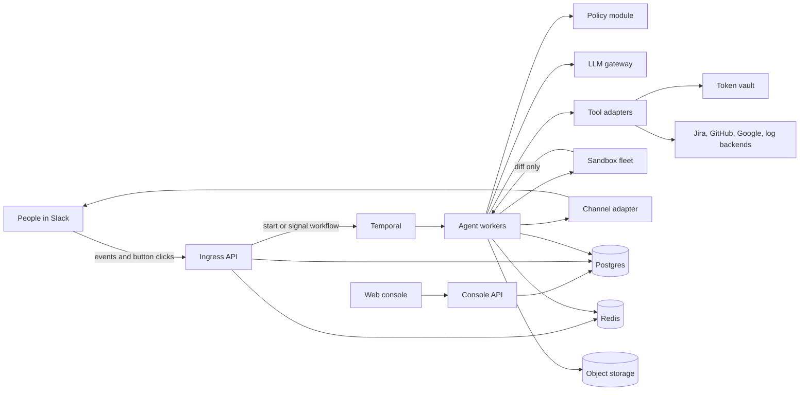
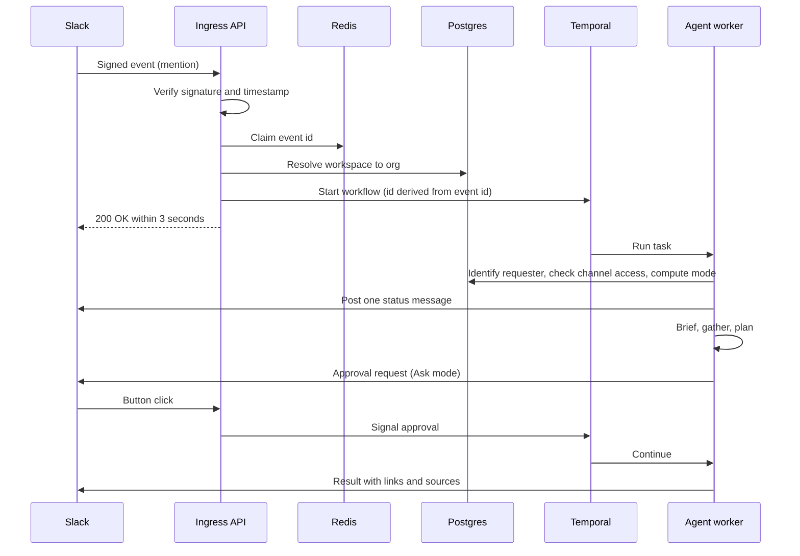
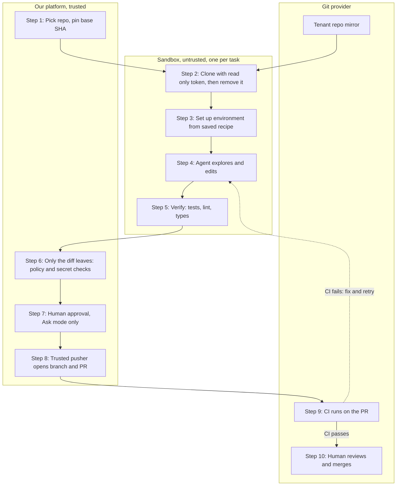

# Slack Agent Platform: Requirements and Technical Specification

| | |
|---|---|
| **Status** | Draft v1 |
| **Date** | October 15, 2026 |
| **Owner** | (fill in) |
| **Companion files** | `schema.sql` (initial Postgres migration, tested) |

## Contents

1. [Summary](#1-summary)
2. [Problem, goals and non goals](#2-problem-goals-and-non-goals)
3. [Users and use cases](#3-users-and-use-cases)
4. [Product requirements](#4-product-requirements)
5. [Decision log](#5-decision-log)
6. [Architecture](#6-architecture)
7. [Agent design](#7-agent-design)
8. [Coding path: sandboxed repository work](#8-coding-path-sandboxed-repository-work)
9. [Security and permissions](#9-security-and-permissions)
10. [Slack platform constraints](#10-slack-platform-constraints)
11. [Infrastructure and deployment](#11-infrastructure-and-deployment)
12. [Multi tenancy and scale](#12-multi-tenancy-and-scale)
13. [Data model](#13-data-model)
14. [Service layer design (next step)](#14-service-layer-design-next-step)
15. [Evaluation and quality](#15-evaluation-and-quality)
16. [Non functional requirements](#16-non-functional-requirements)
17. [Roadmap](#17-roadmap)
18. [Risks and open questions](#18-risks-and-open-questions)
19. [References](#19-references)

---

## 1. Summary

We are building a multi tenant AI agent that works as a general teammate inside Slack, with other chat platforms to follow. People in different roles (engineers, managers, QA and others) ask it to do real work across their tools: read and summarize conversations, create and assign Jira tickets, investigate issues using logs and code, plan and implement changes, raise and update pull requests, and deliver scheduled reports.

Each customer is an **org**. Admins configure the agent through a **web console**: which Slack channels it may read, which tools it may use, which models and limits apply, and custom roles that tell the agent how to tailor its responses.

Three principles shape every design decision in this document:

1. **The agent always acts within the requesting person's own access**, never the bot's full reach.
2. **Safety is enforced in code and in the database**, never by instructions in a prompt.
3. **New use cases come from tools, playbooks and roles**, not from new code paths per use case.

---

## 2. Problem, goals and non goals

### 2.1 Problem

Work in engineering teams starts in chat. A bug is reported in a channel, discussed across a thread, partly diagnosed from logs, and eventually fixed in code, with Jira tracking it along the way. Moving between Slack, Jira, logs and the repository costs time, and context gets lost at every hop. The core challenge is not the agent's raw capability; it is how well it **extracts and manages context**, **plans**, and **delegates and executes** work, end to end, from inside Slack.

### 2.2 Goals

- One agent in Slack that people across roles use for a wide range of tasks.
- Strong context handling: pull the right context from Slack, Jira, Git and logs, build a sourced picture, plan, then execute.
- Safe by construction: permission aware reads and outputs, approvals for risky actions, full audit trail.
- A multi tenant SaaS product, configured per org by admins.
- Extensible: adding a use case means adding a tool adapter, a playbook or a role, not changing the core.
- A platform neutral core, so Slack is the first channel rather than the only one.

### 2.3 Non goals for v1

- Chat platforms other than Slack (the channel abstraction is built now; adapters come later).
- Git providers other than GitHub.
- Multiple Slack workspaces per org (the data model supports it; the product does not expose it yet).
- Role based permissions (roles only tailor responses in v1).
- Model choice across providers (admins choose tiers within one provider family).
- Long term personal memory per user.
- Merging pull requests or deploying code. The agent never does either.
- Self hosted or in VPC deployment (the architecture keeps this possible; see 12.1).

---

## 3. Users and use cases

### 3.1 Personas

Roles are custom per org. These are typical examples, not built in types.

| Persona | Typical needs |
|---|---|
| **Org admin** | Set up the org, connect tools, choose channels, define roles and policies, set limits, invite people |
| **Engineer** | Understand issues, see assigned tickets, plan solutions, implement changes, raise and update PRs |
| **Manager** | Triage reported issues, create and assign tickets, track progress |
| **QA** | Track bugs, schedule recurring summaries and progress reports |

### 3.2 Example 1: Jira tickets from chat

An engineer or manager asks the agent about issues reported in `#bugs`, then asks it to create Jira tickets and assign them to the right engineers.

1. The agent confirms `#bugs` is on the admin allowlist and the requester is a member of it.
2. It reads recent threads on demand, groups related reports, and checks for existing Jira tickets to avoid duplicates.
3. It proposes tickets (title, description, links back to the Slack threads) with suggested assignees, drawn from the service catalog owners, CODEOWNERS and Jira components.
4. In Ask mode, it posts the proposal for approval. In Auto mode (if the admin ceiling allows), it proceeds.
5. It creates the tickets using the requester's linked Jira account and posts the links in the thread.

### 3.3 Example 2: Working on a ticket end to end

1. An engineer asks for their assigned tickets and picks one.
2. The agent builds a brief from the ticket, linked Slack threads, relevant logs and the repository, and brainstorms approaches with the engineer in the thread.
3. It produces an implementation plan with evidence, steps, files touched, risks and a verification method.
4. On request, it implements the change in an isolated sandbox, runs tests, and raises a PR linked to the ticket and thread.
5. Review comments on the PR reach the agent through webhooks; the engineer can ask it to address them, and it pushes revisions.

### 3.4 Example 3: Scheduled summary reports

1. A QA user schedules a recurring report, for example a daily summary of a channel or a daily Jira progress report (tickets opened, closed and so on).
2. Each run is evaluated against the owner's current access, computes all numbers with code (Jira queries, message counts), and has the model write only the narrative.
3. The report is delivered to a channel or by DM on schedule.

### 3.5 What "flexible" means

The examples above are not separate features. They are the same generic loop (understand, gather, plan, act, verify, report) running different **playbooks** over different **tools**, with responses shaped by the requester's **role**. Orgs can add their own playbooks (runbooks, conventions) and roles without code changes.

---

## 4. Product requirements

### 4.1 Orgs, users and privileges

1. Signup creates an org and makes that person its admin.
2. Admins invite users by email. Invited users can use the agent in Slack as soon as their Slack email matches the invite, even before they complete console signup.
3. Two privilege levels: **Admin** and **User**. Admins can promote and demote; an org can have several admins.
4. An org must always keep at least one active admin.
5. A person can belong to several orgs. The console has an org switcher; in Slack, the workspace determines the org.
6. Removing a user revokes their linked accounts, pauses schedules they own, closes their sessions and cancels their running tasks.
7. When someone who is not an invited org user mentions the agent, they get a private reply explaining they need access, and admins are notified with a one click invite.

### 4.2 Custom roles

1. Admins create roles with a title and a description. The description tells the agent how to tailor responses for people in that role.
2. A user can hold several roles. Exactly one is **primary**; it is listed first in the prompt and resolves conflicting guidance.
3. In v1, roles shape tone, depth and content only. They never grant or restrict access.
4. The data model leaves room to attach tool and action policies to roles later.

### 4.3 Slack integration and channel access

1. One Slack workspace per org at launch.
2. Admins choose which channels the agent may access (the allowlist).
3. The agent reads a channel on someone's behalf only if the channel is allowlisted **and** the requester is a member of it.
4. The bot generally has to be a member of a channel to read it, so the console shows bot membership and helps fix it.
5. Each Slack thread or DM conversation is one session. Several people can talk in a session; the agent tracks who the requester is on each turn.
6. Users can manage their own settings (linked accounts, schedules, Ask or Auto choice) in the Slack App Home as well as the console.

### 4.4 Integrations and credentials

1. Admins enable tools per org: Jira, GitHub, Google Cloud Logging, Google Sheets, Google Drive, Gmail and others.
2. Admins connect each tool once for the org. Users can optionally link their own accounts.
3. Every tool operation has a credential mode, with defaults in code and admin overrides per org:

| Mode | Used for | Behavior |
|---|---|---|
| `org` | Low sensitivity reads | Use the org connection |
| `org_with_check` | Sensitive reads | Use the org connection after verifying the requester can access the resource |
| `user_required` | All writes, some sensitive reads | Use the requester's linked account; prompt them to link if missing |

4. Customer supplied MCP servers can be added only with admin approval.
5. The console shows the health of every connection.

### 4.5 Autonomy: Ask and Auto

Every action belongs to a tier:

| Tier | Examples | Ask mode | Auto mode |
|---|---|---|---|
| **Read** | Search, fetch, summarize | Automatic | Automatic |
| **Reversible write** | Create a branch, open a PR, draft a ticket, post a comment | Needs approval | Automatic |
| **Irreversible or outward facing** | Merge, deploy, delete, message people outside the thread, change infrastructure | Always needs approval, or disabled by admin | Always needs approval, or disabled by admin |

1. Admins set the maximum autonomy per org, channel or repository. The most specific setting wins (repository over channel over org).
2. Users choose Ask or Auto within that ceiling. With no settings, the default is Ask.
3. Auto drops to Ask automatically on low confidence, sensitive paths (auth, payments, migrations, infrastructure config) or plans above a size threshold.
4. Approvals appear as buttons in the thread. Depending on the action, the requester, an active admin, or either can decide. Approvals expire, and decisions are final.

### 4.6 Scheduled reports

1. Any user can create scheduled reports, limited to channels and tools they can access themselves.
2. Each schedule has an owner, a cron expression with a time zone, an instruction, and a delivery target (a channel or a DM).
3. Admins see every schedule and can pause any of them. Orgs have a limit on active schedules.
4. Permissions are evaluated against the owner at every run, not only at creation.
5. If the owner leaves or loses access, the schedule pauses and admins are asked to reassign or delete it. If a delivery channel leaves the allowlist, schedules delivering there pause.
6. Numbers in reports are computed by code; the model writes only the narrative.
7. Start times are staggered so every tenant's 9 AM report does not run at the same instant.

### 4.7 Admin console

| Area | Contents |
|---|---|
| Org and users | Invite, promote, demote, remove; org switcher; access requests |
| Roles | Create, edit, archive; assign to users with a primary role |
| Slack | Install, channel allowlist, bot membership status |
| Integrations | Enable tools, connect org accounts, credential mode overrides, health |
| Autonomy | Ceilings per org, channel and repository |
| Models and limits | Default and allowed model tiers, token limits, concurrency, retention |
| Schedules | All schedules, owners, status, pause and resume |
| Usage | Tokens and cost per user, task type and day |
| Audit | Every agent action and policy decision, filterable |
| Service catalog | Services, repositories, log sources, owners and channels (proposed by the agent, confirmed by admins) |

### 4.8 Models, limits and cost

1. Admins choose a default model tier and the allowed tiers, within one provider family.
2. Limits: tokens per user per day, tokens per org per month, maximum concurrent tasks, maximum active schedules, retention days.
3. Budgets are checked before a task starts and between steps. If exceeded, the agent finishes the current step, stops cleanly and reports what was done. It never stops in the middle of a write.

---

## 5. Decision log

All decisions below were reviewed one by one. Where an alternative was rejected, the main reason is noted.

### 5.1 Product decisions

| # | Topic | Decision | Main reason |
|---|---|---|---|
| P1 | Orgs and workspaces | One workspace per org now; data model allows many | Simple v1 without a later migration for Enterprise Grid customers |
| P2 | Matching Slack users | Slack email must match an invited org user | Automatic for users, still under admin control |
| P3 | Uninvited users | Private decline plus access request with one click invite | No data exposed, adoption can still grow |
| P4 | Integration credentials | Org connection by admins, plus optional user links | Writes happen in the user's name and within their access |
| P5 | Roles | Tailoring only in v1; room for policies later | Avoids a redesign when customers ask for role permissions |
| P6 | Ask or Auto | Admin ceiling, user chooses within it | Power users get speed, admins keep control |
| P7 | Who creates schedules | Any user, within their own access | The QA example should not need an admin each time |
| P8 | Schedule owner leaves | Pause and notify admins | No report runs with permissions nobody holds |
| P9 | Channel reads | Allowlist plus requester membership | Prevents reading private conversations through the agent |

### 5.2 Technical decisions

| # | Area | Decision | Main reason |
|---|---|---|---|
| T1 | Channel layer | Agent emits intents; platform adapters render them natively | Second platform becomes an adapter, not a rewrite |
| T2 | Console auth | Clerk | SSO and org features without building auth |
| T3 | Policy enforcement | Central policy module in code now; Cedar or OpenFGA later | Clean interface now, engine when rules grow |
| T4 | Credentials | Mode per operation (see 4.4) | Balances onboarding friction with least privilege |
| T5 | Integrations | Native clients for Slack, Jira, GitHub; vendor MCP servers for the long tail | Reliability where it matters most, coverage elsewhere |
| T6 | Slack reads | Bot token plus cached membership check | User tokens would require broad scopes from every user |
| T7 | Agent loop | Own thin orchestrator; Claude Agent SDK inside the sandbox for coding | Policy, tenancy and Slack logic stay ours; mature coding loop reused |
| T8 | Models | One provider family, admins pick tiers | Quality and testing over breadth in v1 |
| T9 | Durable execution | Temporal Cloud | Retries, timers, approval waits and versioning without running a cluster |
| T10 | Scheduling | Temporal Schedules | One less system |
| T11 | Sandboxes | Managed provider behind our own interface | Ship faster; self host later for enterprise or residency |
| T12 | Budgets | Checked before start and between steps | Never leave half finished writes |
| T13 | Slack data | Store derived artifacts and permalinks, never raw messages | Fits Slack terms and customer privacy |
| T14 | Settings | Web console for admins; App Home for user settings | Users rarely need to leave Slack |
| T15 | Tracing | OpenTelemetry plus self hosted Langfuse | Tenant data stays under our control |

### 5.3 Data model decisions

| # | Topic | Decision |
|---|---|---|
| D1 | Roles per user | Several roles, exactly one primary |
| D2 | Orgs per person | Global users who can belong to several orgs |
| D3 | Org settings storage | Typed columns for anything enforced; one `jsonb` column for display settings |
| D4 | Channel membership | Durable copy in Postgres, hot cache in Redis, periodic reconciliation with Slack |

---

## 6. Architecture

### 6.1 Components

| Component | Responsibility |
|---|---|
| **Web console** | React app for admins and users (orgs, roles, channels, integrations, policies, schedules, usage, audit) |
| **Console API** | FastAPI service behind the console; authenticates with Clerk; runs every query under the org's row level security |
| **Ingress API** | FastAPI service for Slack events, interactions and other webhooks. Verifies, deduplicates, resolves the org, enqueues and acknowledges. Never runs agent work |
| **Workflow engine** | Temporal: durable tasks, approval waits, retries, schedules |
| **Agent workers** | Orchestrator and subagents executing playbooks |
| **Policy module** | Approves or blocks every tool call and every output (see 9.2) |
| **Tool adapters** | Slack, Jira, GitHub (native); Google tools, log backends and others (vendor MCP behind our adapter) |
| **Token vault** | Holds OAuth tokens; issues short lived, task scoped credentials |
| **LLM gateway** | Every model call: routing, per tenant limits, caching, metering, fallback |
| **Sandbox fleet** | Isolated environments for repository work |
| **Channel adapter** | Renders agent intents (reply, progress, approval request, report) as Slack messages |
| **Data stores** | Postgres (state), Redis (dedupe, locks, counters, membership cache), object storage (large artifacts) |
| **Observability** | OpenTelemetry traces and self hosted Langfuse for model calls |

### 6.2 System diagram

### 6.3 Lifecycle of a request from Slack

### 6.4 Lifecycle of a scheduled report

1. Temporal Schedules fires the run at a staggered time near the configured time.
2. The worker creates a task with trigger `schedule` under the owner's identity and checks the schedule is still active.
3. The policy module evaluates the owner's current access to every source and the delivery channel.
4. Data is fetched and numbers are computed in code; the model writes the narrative.
5. The report is delivered; usage and audit events are recorded. Any access failure pauses the schedule with a reason and notifies admins.

---

## 7. Agent design

### 7.1 Generic loop and playbooks

Every task runs the same loop: **understand, gather, plan, act, verify, report**. A **playbook** specializes it for a task type by defining:

- what context to gather and from which tools,
- what the plan must contain,
- what "verified" means,
- what the output looks like.

Requests are classified to a playbook first; if unclear, the agent asks. Built in playbooks ship with the product; orgs can add their own. Playbooks are versioned and a task pins the version it started with.

### 7.2 Context management

This is the core of the product and gets the most engineering attention.

**The brief.** Every task starts by turning the conversation into a structured brief: goal, facts, constraints, decisions (and who made them), open questions, and entities (services, IDs, time windows, files, people). Every item links to its source. The agent follows links one hop, reads images, separates decided from speculated, and lets later messages override earlier ones. In Ask mode the brief is posted for correction; in Auto mode it is posted as information. Every later retrieval is driven by the brief's fields.

**Isolated subagents.** Each heavy source (logs, code, ticket history) is handled by a subagent with its own context that returns a compact, structured, sourced summary. Raw tool output never floods the orchestrator.

**Tool loading.** Admin settings decide which tools exist for an org; the current phase decides which are loaded into context. Tool output is capped and summarized above the cap.

**Code execution with tools.** Where useful, the agent calls tools from code in the sandbox so filtering and aggregation happen before the model sees the data.

**Observability interface.** Log backends differ per customer (Cloud Logging, CloudWatch, Datadog, Loki, Elastic, Splunk, Sentry). The agent sees one interface (search events by service, window, severity and text; fetch a trace; list error groups) returning one normalized shape. Adapters push filtering to the backend's own query language and return aggregates plus samples, grouped by error signature with counts and first and last seen.

**Service catalog.** A per org map of services to repositories, log sources, owners and channels, proposed by the agent from repo scans and confirmed by admins. It drives repository selection, log queries and assignee suggestions.

**Durable state.** The brief, plan and step log live in the database and are fed back in each turn, so long sessions and resumed tasks stay coherent.

### 7.3 Planning

- Plans follow a template per playbook: goal, evidence with sources, ranked hypotheses where relevant, steps, repositories and files touched, risks, verification, rollback.
- If the core assumption has no evidence, the next step is investigation, not implementation.
- Bug work follows "reproduce first": a failing test before the fix.
- The agent replans when verification fails twice or new evidence contradicts an assumption.
- Plans that need approval go through the approval flow in 4.5.

### 7.4 Delegation

- The **orchestrator** owns the brief, plan and state, and is the only component that talks to the user.
- **Workers** (investigators, implementer, reviewer) get a narrow task, a narrow toolset and a fixed return schema.
- Investigations run in parallel; writes run one at a time per repository.
- The **reviewer** sees only the diff and the plan, never the implementer's reasoning.
- **Delegating to humans** is a step type: ask a specific person a specific question and pause until they answer.

### 7.5 Sessions and memory

- A thread (or DM conversation) is a session. At most one task runs per session at a time; further requests queue.
- Org level knowledge (service catalog, playbooks, repository cards) is the memory in v1. Personal long term memory is out of scope.

### 7.6 Role tailoring

The requester's roles are injected as a clearly bounded section of the system prompt, primary role first. They shape tone, depth and format only. They never change what the agent is allowed to do.

### 7.7 Failure behavior

When logs have aged out, access is denied or a bug will not reproduce, the agent says so plainly with a confidence level. It never produces a confident plan from thin evidence, and every report states what was verified and what was not.

---

## 8. Coding path: sandboxed repository work

### 8.1 Approach

Repository work happens in an **isolated sandbox per task**: clone, explore, edit, test. Exploring code through a provider API is slow and cannot run anything; a real checkout gives search, navigation, tests and linters. The sandbox is treated as **untrusted**, because install scripts, test code, vendored dependencies and model written code all run there.

The sandbox is destroyed after each run. The diff and base SHA are saved so the workspace can be rebuilt after an approval wait or for a fix.

### 8.2 Rules

1. The orchestrator and its credentials stay outside the sandbox. If the coding harness runs inside it, model calls go through a proxy that injects credentials, so no raw key enters the sandbox.
2. The sandbox clones with a short lived, read only token that is removed after the clone.
3. **The sandbox never pushes.** It produces a diff; a trusted pusher outside checks it and pushes.
4. The pusher only writes to branches under a fixed prefix, never the default branch, never force pushes.
5. The GitHub App is never granted permission to modify workflow files, so a manipulated agent cannot alter CI to exfiltrate secrets.
6. No production credentials in sandboxes; the cloud metadata endpoint is blocked; egress goes through an allowlist; CPU, memory, disk and time are limited.

### 8.3 Challenges and how we handle them

| Challenge | Handling |
|---|---|
| Large repos, LFS, submodules | Per tenant mirror updated by push webhooks; shallow and blobless clones; sparse checkout for monorepos; history fetched on demand |
| Navigating large codebases | Text search and the repo card first; a symbol index next; language servers later for typed languages; read file ranges, not whole files |
| Getting tests to run | Read the repo's CI config first; use its devcontainer, Dockerfile or setup script; otherwise build and save a recipe per repo; customers supply registry credentials through the vault; run only affected tests; fall back to customer CI as verifier |
| Long approval waits | Persist base SHA, diff and image ID; destroy the sandbox; rebuild on resume |
| Main branch moves during the task | Record base SHA; rebase before the PR; resolve and reverify, or report the conflict |
| Diff quality and scope | Size limits, protected paths per tenant, no generated files, formatter and linter on changed files only; oversized or sensitive diffs drop to Ask |
| Secrets committed in repos | Exclude secret file patterns from reads; scan tool output, diffs and PR text; redact before anything leaves |
| Prompt injection from code | Repo content is data; instruction files are honored only if the customer opts in, and never expand permissions |
| Changes across repositories | One sandbox with all involved repos; linked PRs with a stated merge order |
| Review loop | PR review webhooks map comments back to the task; revisions run in a rebuilt sandbox |
| Reproducibility | Record base SHA, environment image, commands and outputs; the PR states what was and was not verified |

### 8.4 Blockers to plan for

1. **Self hosted Git behind a firewall** (GitHub Enterprise Server, GitLab self managed). Needs a runner in the customer's network; another reason for the control plane and data plane split.
2. **Code may not leave the customer's environment.** Answer: data plane in their cloud, models through their own Bedrock or Vertex AI account.
3. **Unbuildable environments.** Private registries, internal services or heavy builds we cannot reach. Answer: CI as verifier and clear reporting.
4. **Git provider coverage.** A provider interface now, with only GitHub implemented.
5. **Branch protection and compliance rules** (signed commits, required reviewers, restricted pushers). Detect at onboarding, not at the first push.

---

## 9. Security and permissions

### 9.1 Core principle

The agent acts within the requesting person's own access. Effective access is the intersection of what the bot can reach and what the requester can reach. Output is checked against its audience: content from private channels or restricted sources goes only to the requester unless everyone in the channel could see it.

### 9.2 Policy enforcement

A single policy module runs before every tool call and every output. It answers:

1. Is the tool enabled for this org?
2. For channel reads: is the channel allowlisted and is the requester a member?
3. Does the action tier fit the effective Ask or Auto mode?
4. Which credential applies (org, org with check, user)?
5. Is the output safe for its audience?

Every decision is written to the audit log. Enforcement lives in code and the database; the model can be persuaded, the policy module cannot.

### 9.3 Prompt injection

Slack messages, log lines, tickets, code comments and tool results are untrusted input. An agent that reads untrusted text, holds private data and can write to a repository or the network is the classic exfiltration setup. Mitigations:

- Least privilege, short lived, task scoped tokens.
- Instructions found inside fetched content are treated as data.
- Writes require the policy check and, where the tier demands, human approval.
- Sandboxes have an egress allowlist and no route to the control plane.

### 9.4 Secrets and data handling

- Tokens are envelope encrypted with per tenant KMS keys, readable only by the vault service, and never placed in model context.
- Secrets and personal data are redacted from tool output before the model, Slack or a PR sees them.
- No raw Slack message history is stored.
- Zero data retention with the model provider; data residency per tenant (see 12.6).

### 9.5 Audit

Every tool call, write, policy decision and approval is recorded with actor, task, target, decision and reason. The audit log is append only for the application.

---

## 10. Slack platform constraints

| Constraint | Impact | Plan |
|---|---|---|
| Commercial distribution must go through the Slack Marketplace | Required for a customer product | Treat Marketplace approval as a critical path item and start early |
| Commercially distributed apps outside the Marketplace get 1 request per minute on `conversations.history` and `conversations.replies`, with page size reduced to 15 | Unusable for reading threads until approved | Marketplace approval; read on demand only |
| Bulk indexing of Slack data is outside permitted use | No workspace wide indexing or embedding | Fetch the invoking thread and linked messages on demand; store only derived artifacts |
| Socket Mode apps cannot be listed in the Marketplace | Need public HTTPS endpoints | Events API over HTTP behind the ingress service |
| Events must be acknowledged within about 3 seconds; Slack retries failures | Duplicates and timeouts | Acknowledge before any model call; deduplicate by event ID |
| Every extra OAuth scope slows review and worries security teams | Adoption and approval risk | Minimal scopes; justify each one |
| Message size and block limits | Long reports do not fit | Canvases or files for long output; one status message edited in place |
| Posting and update rate limits | Many concurrent tasks can hit limits | Coalesced, throttled updates through a rate limited outbound queue per workspace |

Slack's AI app surfaces (assistant threads, status indicators) should be used for a native feel.

---

## 11. Infrastructure and deployment

### 11.1 Service layout

FastAPI is the **front door, not the runtime**. Agent work runs for minutes to hours and must survive deploys, scale in and crashes, so it never runs inside web request handlers or background tasks.

| Service | Scaling signal | Notes |
|---|---|---|
| Ingress API | Request rate | Stateless; verify, deduplicate, resolve, enqueue, acknowledge |
| Console API | Request rate | Stateless; Clerk auth; every request in one tenant transaction |
| Agent workers | Queue depth and tasks in flight | Async, I/O bound; memory capped per process; graceful shutdown checkpoints the current step |
| Sandbox fleet | Task demand | Separate node pools or managed provider; warm pools only for active tenants |
| LLM gateway | Request rate | Central quotas, retries, fallback, metering |

Serverless functions are not suitable for agent runs (execution time caps such as Lambda's 15 minutes).

### 11.2 Durability and idempotency

- Temporal holds execution state; tasks checkpoint after every step and can pause for approvals for days.
- Every side effect carries an idempotency key, stored and checked before acting, so a resumed task never posts twice or opens two PRs.
- Retries with backoff, circuit breakers per dependency, a dead letter path, and a clear failure message in the thread when a task gives up.

### 11.3 LLM gateway

All model calls go through one internal gateway: per tenant token buckets, priority lanes, retries, fallback across regions or routes (the provider family is available directly and through Bedrock and Vertex AI, which gives separate quota pools), prompt caching for stable context, and usage events for metering. Cheaper tiers handle classification and log summarization; larger tiers handle reasoning and code.

### 11.4 Observability

One trace per task across API, queue, worker, sandbox, model and tools, tagged with tenant ID on every span. Redaction happens before storage. Per tenant dashboards cover success rate, latency, cost and errors. Support staff reach tenant traces only through audited, time boxed approval.

### 11.5 Releases and versioning

Prompts, playbooks, tools and models change often while tasks may wait days. Each task pins the versions it started with; workflows are versioned so tasks in flight finish on old code. Releases are gated on the eval suite (section 15), canaried to a tenant cohort, then rolled out. Enterprises can pin model versions.

### 11.6 Cloud mapping

The cloud is not yet chosen (see 18.2). Both work; the control plane and data plane split matters more than the vendor.

| Need | AWS | GCP |
|---|---|---|
| APIs and workers | ECS or EKS | Cloud Run or GKE |
| Durable workflows | Temporal Cloud | Temporal Cloud |
| Postgres | RDS or Aurora | Cloud SQL or AlloyDB |
| Redis | ElastiCache | Memorystore |
| Keys and secrets | KMS, Secrets Manager | Cloud KMS, Secret Manager |
| Models | Bedrock | Vertex AI |
| Self hosted sandboxes later | EKS with gVisor or Kata | GKE Sandbox |

---

## 12. Multi tenancy and scale

### 12.1 Isolation model

Pooled by default: shared APIs and workers, tenant scoped data, a sandbox per task. The system is designed with a **control plane and data plane split** so the data plane (workers, sandboxes, connector adapters) can later run in a dedicated account or the customer's own cloud without a rewrite. Enterprise buyers of a tool that reads production logs and code will ask for this.

### 12.2 Noisy neighbors

Fair scheduling or per tenant queues, concurrency caps and quotas by plan, and priority lanes so interactive work (replies, approvals) beats batch work (catalog builds, reports).

### 12.3 Shared external limits

The model provider quota is one pool shared by all tenants, so the gateway enforces per tenant limits. GitHub uses a GitHub App so limits and tokens are per installation. Slack, Jira and log APIs get separate limiters keyed by tenant.

### 12.4 Credentials at scale

A separate vault service; short lived, task scoped tokens; envelope encryption with per tenant KMS keys. For customer cloud access: cross account role assumption with an external ID on AWS, Workload Identity Federation on GCP, never uploaded keys. Refresh, revocation and uninstall events are handled automatically.

### 12.5 Data isolation and deletion

Tenant ID on every row, object key, cache key and trace span; Postgres row level security under the application checks; per tenant prefixes and lifecycle rules in object storage; an offboarding job that deletes across every store; backups expiring on a documented schedule; cross tenant isolation tests in CI.

### 12.6 Residency and compliance

Region is a tenant attribute from day one. Data planes deploy per region, and model calls are pinned to in region endpoints. SOC 2 should start early since it gates enterprise deals.

### 12.7 Efficiency

- Pull customer data efficiently: push filtering to the source and fetch aggregates and samples, not raw logs.
- Keep high volume events (model calls, tool calls) out of the main database: traces and large payloads go to object storage or Langfuse; usage and audit tables are partitioned by month.
- Connection pooling (PgBouncer or RDS Proxy) for many workers.

---

## 13. Data model

The full, tested migration is in `schema.sql` (PostgreSQL 16; runs on 15 and later).

### 13.1 How tenant isolation works

1. Every tenant table has `org_id`. Row level security limits each query to the org named in the transaction setting `app.org_id`.
2. The API sets it at the start of every transaction with `set_config('app.org_id', ..., true)`. Transaction scope matters: a pooled connection must never carry one tenant's context into another tenant's request.
3. No setting means no rows: reads return nothing and writes fail.
4. Children reference parents through composite `(org_id, id)` foreign keys, so a row in one org can never point at a row in another, even with a guessed ID. Foreign key checks bypass row level security, which is why this matters.

### 13.2 Database roles

| Role | Used by | Access |
|---|---|---|
| `app_owner` | Migrations | Owns all objects |
| `app_user` | Console API, ingress, workers | Tenant tables under row level security; read only on users and memberships; can rename its org and change its settings; append only on audit and usage |
| `app_vault` | Token vault service | The only role that can read or write token ciphertext |
| `app_identity_sync` | Clerk webhook handler | Writes orgs, users and memberships; cannot read work data |
| `app_maintenance` | Retention, offboarding, partitions, reconciliation | Bypasses row level security; used only by trusted jobs |

### 13.3 Tables by domain

| Domain | Tables | Notes |
|---|---|---|
| Orgs and people | `orgs`, `org_settings`, `users`, `org_memberships`, `custom_roles`, `membership_roles`, `access_requests` | Users are global and exist from invite time so Slack email matching works before signup; Clerk is the source of truth, synced by webhooks |
| Platform layer | `workspaces`, `platform_identities`, `channels`, `channel_members` | `platform` and `enterprise_id` columns allow more platforms and workspaces later |
| Integrations | `org_integrations`, `connections`, `connection_secrets`, `operation_policies` | The integration catalog and per operation defaults live in code; the database stores what an org changes |
| Code and catalog | `repositories`, `services`, `service_owners`, `service_channels` | Repository cards, setup recipes, snapshot images, protected paths |
| Autonomy | `autonomy_policies`, `user_preferences` | Ceilings per org, channel or repository |
| Playbooks | `playbooks` | Built in rows have no org; versions are immutable |
| Work | `sessions`, `tasks`, `task_steps`, `approvals`, `external_actions`, `artifacts`, `task_links` | Temporal is the source of truth for execution; these are the product's view, for Slack updates, the console and audit |
| Schedules | `schedules` | Each run creates a task with trigger `schedule` |
| Usage and audit | `usage_events`, `usage_daily`, `audit_log` | Partitioned by month; append only for the application |

IDs are time ordered UUIDs (version 7). Statuses and kinds are text with check constraints rather than enum types, so values can evolve with simple migrations.

### 13.4 Guarantees enforced by the database

Each of these is covered by a test that ran against a live Postgres 16 instance (28 of 28 passing).

| Guarantee | Mechanism |
|---|---|
| Each org reads only its own rows; no context means no rows | Row level security on every tenant table |
| No inserting, moving or linking rows across orgs | Policy `with check` plus composite foreign keys |
| Only the vault reads secrets, and only for the current org | Grants plus row level security |
| The users table shows only people in the current org | Policy joined to memberships |
| Partitions are reachable only through the parent | No grants on partitions |
| Audit and usage are append only for the application | Insert and select grants only |
| Built in playbooks shared, org playbooks private, versions immutable | Policies plus a column level update grant on `enabled` only |
| An org always keeps an active admin, even under concurrent demotions | Trigger with a row lock on the org |
| Several roles per user, exactly one primary, automatic promotion when the primary is deleted | Partial unique index, deferred constraint trigger, promotion trigger |
| Effective mode is the user's choice capped by the most specific ceiling | `app.effective_mode()` |
| Channel reads require allowlist plus membership | `app.can_read_channel()` |
| Routing works before the org is known | `app.resolve_workspace()` and `app.resolve_task_links()` |
| One running task per thread; terminal states need a finish time | Partial unique index and check constraint |
| Approvals decided only by the right person, before expiry, once | Trigger |
| Schedule checks: valid time zone and cron, target matches type, per org quota | Triggers and checks |
| Removing a channel from the allowlist pauses schedules delivering there | Trigger |
| Removing a member revokes links, pauses schedules, closes sessions | Trigger |
| Artifact retention defaults from org settings; one body per artifact | Trigger and check |
| Usage rollups per member and for system usage | Trigger with upsert |
| Idempotency keys unique per org; one active org connection per tool; custom MCP needs approval | Unique indexes and checks |
| Deleting an org removes all its data and leaves other orgs intact | Cascading foreign keys |

### 13.5 What stays out of Postgres

| Data | Where |
|---|---|
| Raw Slack messages | Never stored; fetched on demand |
| Execution state | Temporal |
| Traces and prompts | Langfuse |
| Large artifacts and diffs | Object storage, referenced by `storage_ref` |
| Hot counters, locks, dedupe keys, membership cache | Redis |
| Integration catalog and operation metadata | Code |

### 13.6 Deployment notes

1. Roles are created without login. `BYPASSRLS` is not inherited through role membership, so the identity sync and maintenance services must log in as those roles or use `SET ROLE`.
2. Some managed Postgres offerings restrict `BYPASSRLS`. If so, route that work through security definer functions owned by `app_owner`, as the resolvers already do.
3. In PgBouncer transaction mode, a session level setting would leak to the next client; always use the transaction scoped form.
4. Run `app.ensure_monthly_partitions(3)` daily from the maintenance role.
5. New tables in later migrations need explicit grants and, if tenant scoped, the same policy. No default privileges are set, so nothing becomes reachable by accident.

---

## 14. Service layer design (next step)

Designed, not yet built. This is the next implementation step.

### 14.1 Transaction middleware

- Each request gets a unit of work. A dependency binds it to one org, which opens a transaction and sets `app.org_id` as its first statement. Binding a second org in the same request is an error.
- The middleware **commits before the response starts**. Deferred constraint failures (for example the primary role rule) then return an error response instead of a false success.
- Error responses and exceptions roll back. Background work never uses the request's session.
- Database errors map to HTTP responses: insufficient privilege or row level security violation to 403, unique violation to 409, check violation to 422, foreign key violation to 409.

### 14.2 Slack ingress

1. Read the raw body and verify the signature (HMAC SHA256 over version, timestamp and body) and that the timestamp is within 5 minutes.
2. Answer `url_verification` challenges.
3. Claim the event ID in Redis with a short TTL. After a successful enqueue, extend the TTL; if enqueue fails, release the claim and return 500 so Slack's retry can succeed.
4. Resolve the workspace to an org through `app.resolve_workspace()`. Unknown or uninstalled workspaces get a 200 so Slack stops retrying.
5. Start a Temporal workflow whose ID derives from the event ID. Temporal's duplicate ID rejection is a second deduplication layer.
6. Acknowledge with 200. Interactions (button clicks) follow the same path and signal the waiting workflow.

### 14.3 Console authentication with Clerk

- Verify the session token (RS256) against Clerk's JWKS, cached with refresh on unknown key IDs; check issuer, expiry and not before.
- Check `azp` (authorized party) against the console's allowed origins.
- Reject sessions with status `pending`.
- Read the active org from the v2 token's `o.id` claim, falling back to v1's `org_id`.
- Map Clerk user and org to the membership through a security definer resolver (a small second migration adds it). **Privilege comes from our database, not the token.**
- Admin only routes use a dependency that requires an active admin membership.

---

## 15. Evaluation and quality

Context quality is the main focus, so it must be measurable.

| Layer | What we measure |
|---|---|
| Brief | Correct service, time window, IDs and decisions extracted |
| Retrieval | Right error signature found; recall of files the real fix touched; context fetched versus actually used |
| Planning | Root cause match; plan accepted without edits |
| Execution | Tests passing; PR merge rate; revisions needed |
| Reports | Numbers match direct queries exactly |
| Cost and speed | Tokens, cost and wall clock time per task type |

How:

1. **Replay benchmark** from historical tasks with known outcomes (a Slack thread, a log window and the merged fix), starting with our own and then design partners'.
2. **Tracing** every retrieval to compare fetched and used context.
3. **In product feedback**: thumbs up or down per step in Slack.
4. **Shadow mode** for new customers: the agent plans but does not act until trust is established.
5. **Release gate**: every playbook has an eval suite that must pass before rollout.

---

## 16. Non functional requirements

Proposed targets, to be confirmed.

| Area | Target |
|---|---|
| Slack acknowledgment | p99 under 1 second (hard limit about 3 seconds) |
| First visible status in the thread | Under 5 seconds |
| Tenant isolation | Zero cross tenant access, verified by isolation tests in CI |
| Durability | Tasks survive worker restarts and deploys without repeated side effects |
| Ingress availability | 99.9% monthly |
| Retention | Default 90 days, configurable from 1 to 3650 days per org |
| Secrets | Never in model context, logs or traces |
| Auditability | Every write and policy decision recorded |

---

## 17. Roadmap

Proposed phases.

| Phase | Scope | Exit criteria |
|---|---|---|
| **0. Foundations** | Schema, console (orgs, invites, roles, channels, integrations, limits), Slack install and ingress, policy module, Temporal, LLM gateway, tracing; Marketplace submission started | An admin can set up an org and the agent answers in an allowlisted channel within policy |
| **1. Read and report** | Q&A over channels and Jira; scheduled reports (Example 3) | Reports with exact numbers delivered on schedule; access changes pause schedules correctly |
| **2. Act in Jira** | Ticket creation and assignment with approvals (Example 1); service catalog | Tickets created in the user's name with correct assignee suggestions |
| **3. Coding path** | Sandbox, investigation subagents, plan, implement, PR, review loop (Example 2) | Benchmark tasks resolved with merged PRs and no credential exposure |
| **4. Enterprise and expansion** | SSO and SCIM, residency, dedicated data planes, role based permissions, more Git providers, Teams adapter | First enterprise deployment |

---

## 18. Risks and open questions

### 18.1 Risks

| Risk | Mitigation |
|---|---|
| Slack Marketplace approval takes longer than planned; reads are throttled until then | Start submission in phase 0; minimal scopes; design partners first |
| Permission leakage through agent output | Policy check on every output, audience aware posting, isolation tests |
| Prompt injection leading to harmful writes | Least privilege, approval tiers, sandbox egress limits, untrusted content treated as data |
| Customer environments too complex to build in a sandbox | CI as verifier; explicit "not verified" reporting |
| Runaway cost from long tasks | Per task and per tenant budgets, model routing, caching |
| Crowded market: Claude Code, GitHub Copilot, Devin and Cursor all start coding tasks from Slack, and Slack Code hosts coding agents in shared channels | Compete on cross source investigation, service catalog, customer playbooks and governance; delegate code editing to an existing harness; explore integrating with Slack Code |
| Managed Postgres may not allow `BYPASSRLS` | Security definer fallback (13.6) |

### 18.2 Open questions

1. Which cloud: AWS or GCP?
2. Which route to the model provider: direct API, Bedrock or Vertex AI?
3. Which managed sandbox provider?
4. How should assignees be chosen: service catalog owners, Jira components, recent history, or a mix?
5. Pricing, plans and default limits per plan.
6. Does Clerk cover the SSO and SCIM needs of enterprise buyers, or is a second provider needed later?
7. Default retention periods for artifacts, traces and audit logs.
8. Should invited users who have not completed console signup be allowed to use Auto mode?
9. How should Slack Connect and shared channels with external organizations be handled, given the membership and audience checks?
10. Is GitHub only acceptable for the first customers?

---

## 19. References

- [Slack: rate limit changes for non Marketplace apps](https://docs.slack.dev/changelog/2025/05/29/rate-limit-changes-for-non-marketplace-apps)
- [Slack: terms and rate limit update FAQ](https://api.slack.com/changelog/2025-05-terms-rate-limit-update-and-faq)
- [Slack: Web API rate limits](https://docs.slack.dev/apis/web-api/rate-limits)
- [Slack: developer changelog](https://api.slack.com/automation/changelog)
- [Slack: Socket Mode](https://api.slack.com/socket-mode)
- [Dust: notes on the Slack terms and API changes](https://dust-tt.notion.site/Slack-Terms-of-Service-update-and-API-Changes-21728599d94180f3b2b4e892e6d20af6)
- [Anthropic: Code execution with MCP](https://www.anthropic.com/engineering/code-execution-with-mcp)
- [Simon Willison on code execution with MCP](https://simonwillison.net/2025/Nov/4/code-execution-with-mcp/)
- [Clerk: session tokens](https://clerk.com/docs/guides/sessions/session-tokens)
- [Clerk: session token JWT v2 changelog](https://clerk.com/changelog/2025-04-14-session-token-jwt-v2)
- [Techloy: Claude Code in Slack](https://www.techloy.com/claude-code-is-coming-to-slack-to-automate-coding-workflows-for-developers/)
- [Capy: coding agents in Slack](https://capy.ai/articles/coding-agents-in-slack)
- [Slack Code coverage](https://app.dealroom.co/news/feed/slack-code-brings-ai-coding-agents-into-team-channels-with-live-preview-features)
